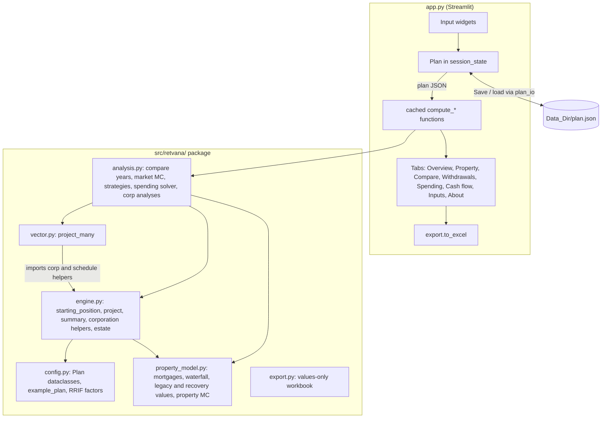

# Design: retvana engine baseline

## Overview

This design describes how the code meets `requirements.md`. It adds no features. It records the
structure, the data flow, the invariants the analyses depend on, and the places where the same rule
is coded twice. Those places are where a future change is most likely to break the contract. The last
section maps every requirement to the checks that cover it.

## Architecture

| Module | Lines | Responsibility | Requirements |
|---|---|---|---|
| `config.py` | 374 | `Plan` and nested dataclasses, JSON round trip, derived end year, `example_plan()` | 1 |
| `property_model.py` | 222 | Mortgage balances, sale waterfall, LTT, legacy factor, recovery simulation, surplus distribution | 3, 4, 5 |
| `engine.py` | 544 | Reference projection: one plan, one return path, a DataFrame of named columns | 2, 6–13, 17 |
| `vector.py` | 234 | The same projection over arrays (paths × years), only the columns the analyses need (`KEEP`) | 14, 16, 20.2 |
| `analysis.py` | 478 | Analyses that run the engines many times | 5.7, 9.7, 14–16 |
| `export.py` | 237 | Excel workbook built from results already computed | 18 |
| `plan_io.py` | 98 | Data_Dir resolution, plan load with fallback, atomic save (added by the open-source-release spec) | 1.3–1.4 |
| `app.py` | 1,322 | Widgets, caching, tabs, charts, themes | 1.3–1.4, 19 |

Dependencies point one way, from app to analysis to engines to property model and config. The
engines never import the app or the analyses.

## Data model

`Plan` is a single dataclass tree: `Person` ×2 (key `P1` / `P2`), `Account[]` (owner, kind
`registered`/`tfsa`, balance, contribution, return, volatility), `ExpenseItem[]` (monthly, optional
later-phase amount, discretionary flag), `OptionGrant[]` (`option_grants`), `ConsultingIncome[]`
(owner, amount, years, `indexed`, `rrsp`, `via_corp`), `Property[]` ("Property 1" to "Property 3"),
`Townhouse`, `Mortgage[]`, `Segment[]`, `LegacyScenario[]`, plus scalar rates and switches
(`base_nonreg_p2`, `options_share_price`, `options_marginal_rate`, `p1_shareholder`, …).

- `to_json` / `from_json` use `dataclasses.asdict` and drop unknown keys, so an older saved plan
  still loads. Missing keys take the dataclass defaults.
- `sync_end_year()` derives `end_year` (Requirement 1.5). Every entry point (`project`,
  `project_many`, `market_shocks`) calls it first, so a stale `end_year` cannot leak in.
- `example_plan()` holds a synthetic household with the model switches at the spreadsheet settings.
  `fresh_plan()` in `app.py` turns on the app defaults. A user's own plan lives only in the Data_Dir.

## Data flow

1. **Starting position** (`engine.starting_position`): grow each account with `fv`; get sale values
   and the townhouse price from `pm.sale_values` (or a supplied `sale` tuple); build the
   `Waterfall`; split the surplus between the two non-registered accounts (`nonreg_p1`,
   `nonreg_p2`); inflate expenses.
2. **Projection** (`engine.project`): one row per year. Each row's opening balances come from the
   previous row's closing columns. The order within a year is fixed:
   1. index the brackets and BPA;
   2. choose the return;
   3. compute spending (go-go or later phase, survivor share);
   4. roll over balances at a death;
   5. compute returns;
   6. look up RRIF factors;
   7. compute CPP (with survivor top-up) and OAS (clawback on last year's income);
   8. add consulting;
   9. work out planned draws for the strategy;
   10. split pension income;
   11. run the corporation step and dividends;
   12. compute income tax;
   13. compute the shortfall;
   14. top up the TFSA;
   15. draw non-registered, then TFSA, then extra registered;
   16. tax the extra draws;
   17. sum total capital.
3. **Summary** (`engine.summary`): capital checkpoints, worst expense/capital ratio, depletion
   year, estate after tax, lifetime tax, CPP+OAS and clawback.
4. **Analyses** copy the plan (`plan.copy()`), change one thing (start year, strategy, spending
   scale, dividend policy, consulting route), then re-run an engine. They never change the
   caller's plan.
5. **App**: `compute*` functions are `st.cache_data` keyed on the plan JSON and the run settings,
   so the same inputs return cached results. Widgets write into the plan before any compute call
   (Requirement 19.1).

## Key algorithms

Each one is specified in the requirements. Only the implementation choices are noted here.

- **Column names.** `engine.project` keeps the original spreadsheet's Projections column letters as
  row keys (`F` Person 1 non-registered, `I` Person 1 registered, `S`/`V` Person 2, `BU`/`BX` TFSA,
  `BA` shortfall, `BB`–`BK` the draw cascade, `CC`–`CN` CPP/OAS, `Q`/`AD` taxable income, `R`/`AE`
  income tax). Columns added after the port use mnemonic names: `T_P1`/`T_P2` TFSA top-up,
  `W_P1`/`W_P2` consulting, `CPP_P1`/`CPP_P2`, `K`/`X` RRSP contributions, `CORP*`, `D_P1`/`D_P2`,
  `CDA`, `RDTOH`, and `age_P1`/`age_P2`. `engine.COLUMNS` maps them to generic display names and
  `engine.column_label` puts in the plan's person names. Keeping the letters made the one-time
  spreadsheet parity check a direct cell-to-key comparison.
- **Draw cascade** (Req 7). Non-registered is drawn only when `F + S > BA`. The TFSA covers the
  rest if more than $0.01 is left. Extra registered covers what remains. The tax on an extra draw
  is taken from non-registered when that account can pay it, otherwise from registered. That is
  the `p['BG'] if F + G − BB − BG < 0` term in next year's opening balance. **(inherited)**
- **Pension splitting** (Req 9.6). Columns `BL`–`BS` reproduce the original spreadsheet's
  three-branch formula. They take effect only when both people are alive.
- **Accurate extra tax.** The tax on an extra draw is the person's tax with the draw minus their
  tax without it. The OAS clawback base `Qc`/`ADc` then includes the extra draw.
- **Corporation** (Req 13). `corp_step`, `corp_pay`, `plan_dividends` and `corp_after_tax` are
  written with numpy operations, so they accept floats or arrays. `vector.py` imports them, so the
  corporate rules exist only once.
- **Property recovery** (Req 5). `simulate` draws a fixed 40-year window
  (`max(T, 40)`) and slices it, so the paths are the same whatever horizon is asked for.
  `n_paths = 0` skips every random draw and returns the median path.
- **Market shocks** (Req 14). `market_shocks` draws `max(T, 80)` years from seed 1971 and slices
  it. Retirement year *y* uses columns from `y − current_year` onward. Shock *t* is therefore the
  same calendar year for every retirement year compared.
- **Bisection.** The spending solver searches 0–4× for 22 steps (resolution about 1e-6).
  `safe_spending` searches 0.3–3× for 18 steps. Both rely on monotonicity while the money lasts
  (Property P3 below). `safe_spending` tests only whether the money lasts, and the solver's test
  requires the money to last as well as the estate target, so the small estate rise after depletion
  does not affect either.

## Invariants the analyses depend on

These hold and each one is checked. They are listed because results stop being valid if a change
breaks one of them.

| # | Property | Relied on by |
|---|---|---|
| P1 | `project_many` equals `project` on every `KEEP` column for any plan, starts and returns | All Monte Carlo results |
| P2 | More starting non-registered money never lowers total capital in any later year | `monte_carlo` picks the P10/P50/P90 capital runs as the paths at those surplus percentiles |
| P3 | A higher spending scale never raises the estate while the money lasts, and never turns a failing plan into a lasting one | Spending solver and `safe_spending` bisection |
| P4 | With zero volatility, every market path equals the deterministic plan | Interpreting market results against the Overview |
| P5 | The same seed and plan give the same random draws, whatever the year range or horizon | Year comparison (common random numbers) |
| P6 | Analyses never change the plan they are given | Cached app results |

P3 is limited to scales where the money lasts. After depletion the estate can rise slightly with
the scale, because the leftover non-registered money is never drawn (inherited all-or-nothing rule,
Req 7.2.1 / 7.5). The bisection is unaffected, since its test also requires the money to last.

P1 and P4 are covered by `vector_check.py`, P2 and P6 by `projection_check.py`, P3 by
`spending_check.py`, and P5 by `property_check.py` and `market_check.py`. P6 was checked on plans
whose end year is already up to date; `project` and `market_shocks` correct an out-of-date end year
in place (Finding 6 in tasks.md).

## Rules coded twice (risk register)

| Rule | Location A | Location B | Difference today |
|---|---|---|---|
| Yearly projection | `engine.project` | `vector.project_many` (own copies of `planned_draw`, `tfsa_room`, `cpp`, `cpp_contrib`, `with_survivor_cpp`, `oas`, `tax`) | None; `vector_check` guards it at 1e-9 |
| Property surplus | `pm.waterfall` (one path) | `pm.surplus_distribution` (vectorized) | None; `property_check` compares them path by path (50 paths) |
| Estate after tax | `engine.estate_after_tax` | `analysis._market_success` (inline formula) | Same formula; `projection_check` compares them on 50 market paths |
| "Money lasts" | `analysis._run_year`: capital ≥ max(`success_floor`, spending) | `spending_outcome` and `_market_success`: capital ≥ spending | The spending solver ignores `success_floor` **(inherited inconsistency)**; recorded by `spending_check` |
| Pre-retirement growth | `engine.fv` (closed form) | `analysis._starts_for_year` (loop, same rule when `mc_pre_retirement` is off) | Equal when volatility is off; `market_check` compares them for retirement 2029–2036 |

The baseline records these and does not merge them. Merging is a refactor and needs its own
change, made with the checks in place. The checks catch any drift.

## Error handling

The engine assumes a valid plan and does no input validation. Division by zero is guarded where
balances can reach zero (`_div` in vector, `C > 0` tests in engine).

- When a plan loads, missing fields take their defaults at every level and unknown top-level keys
  are dropped.
- An unknown key inside a nested object raises `TypeError` (`Person(**x)`).
- In the baseline, the app read the saved plan with no `try`, so an unreadable file stopped the app
  from starting. `plan_io.load_saved_plan` now catches read and parse errors; the app warns, starts
  from the app defaults, disables "Save as default" and leaves the file untouched.

Both are recorded as limitations (Requirement 1.2–1.3). Schema validation of nested objects is left
for a later spec.

## Known divergences from current rules

Inherited from the original spreadsheet and kept for parity. Each needs a deliberate change in a
later spec, most likely as a plan setting, so the original value stays available.

- **RRIF factors** (`config.RRIF_FACTORS`). The table from 71 onward is the pre-2015 one (7.38% at
  71). The current CRA table starts at 5.28%. This overstates forced withdrawals, taxable income and
  OAS clawback from 71. It matters most for the "defer" and "bracket" strategies.
- The other inherited rules are marked in the requirements (6.4, 7.2, 7.3, 7.5).

## Verification design

The checks are plain scripts. Each one exits non-zero on failure and prints one PASS/FAIL line per
assertion. A single runner `scripts/verify.py` (`make verify`) runs every `scripts/*_check.py` and
`smoke_test.py` in turn and reports the overall result (Requirement 20.5).

The spreadsheet parity check ("parity" in the coverage map), with its golden master from the
original spreadsheet, was a one-time Migration check. It proved the engine against the original spreadsheet before the move to this
repository and is not part of it. Its role as the behaviour guard is taken by `regression_check.py`
and `scripts/regression_golden.json`, generated from the Example_Plan.

### Coverage map

| Req | Before baseline | Added by the baseline |
|---|---|---|
| 1 Plan, persistence | smoke (partly) | `plan_check`: JSON round trip equality, unknown keys ignored, end year derivation |
| 2 Starting position | parity (one-time) | `property_check`: same values with the app defaults |
| 3 Property sale | parity (legacy, ACB 0; one-time) | `property_check`: hand-computed waterfall, CGT with ACB set, LTT at bracket edges, `waterfall` = `surplus_distribution` on the median path |
| 4 Legacy scenarios | parity (2 scenarios; one-time) | `property_check`: factor formula for all four, townhouse fixed when not following the market |
| 5 Recovery, property MC | none | `property_check`: no-shock path equals the closed recurrence, sale discount, CRN across horizons (P5), the median-path selection |
| 6 Spending, returns | parity, vector | `projection_check`: phase switch at year 15, survivor share |
| 7 Withdrawals | parity (default switches) | `projection_check`: cascade order and the all-or-nothing non-reg rule, TFSA top-up room steps, survivor surplus |
| 8 Income tax | parity (indirect) | `tax_check`: hand values at and around thresholds, BPA credit, dividend credit floor at 0 |
| 9 Strategies | vector (cases) | `projection_check`: minimum factors, defer start age, bracket fill formula, LIRA unlock at 55, optimizer grid shape |
| 10 Survivor | survivor | none |
| 11 CPP, OAS | parity (indirect) | `benefits_check`: early/late factors, contributory factor, OAS deferral and 75+ uplift, clawback on last year's income |
| 12 Consulting | consulting | none |
| 13 Corporation | corp | none |
| 14 Market MC | vector (zero volatility) | `market_check`: median return equals plan return, first-year shock, CRN across retirement years |
| 15 Year comparison | smoke | `market_check`: column set per mode |
| 16 Spending solver | spending | P3 monotonicity sweep in `spending_check` (estate checked while the money lasts) |
| 17 Estate | corp, spending (indirect) | `projection_check`: hand value; engine formula = `_market_success` formula |
| 18 Export | smoke (runs) | `export_check`: sheet names per mode, Summary keys |
| 19 App, deployment | smoke | `deploy_check`: compose binds 127.0.0.1, `config.toml` address, Dockerfile non-root (static file checks) |
| 20 Verification | all | `verify.py` runner; `regression_check` in place of the one-time parity check |
| P2, P6 | none | `projection_check`: surplus monotonicity sweep, plan unchanged after each analysis |

### Constraints on checks

- Hand calculations are written out in the check as plain arithmetic from the stated rule, not by
  calling the function being tested.
- Checks use `example_plan()` or a small plan built inside the check, so they never depend on a
  personal plan.
- Monte Carlo checks use small path counts (≤ 200) so the whole suite runs in about a minute.
- Golden values (`regression_golden.json`) are only regenerated deliberately with
  `make_regression_golden.py`. They are never regenerated to make a failing check pass.
