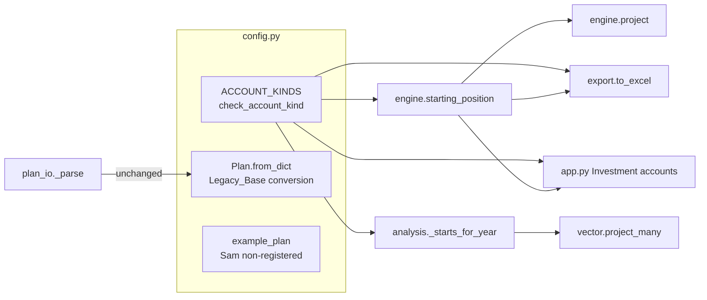
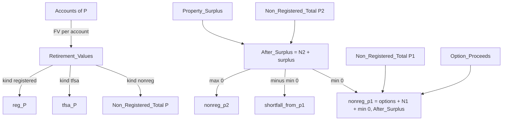

# Design Document: nonreg-accounts

## Overview

This design moves non-registered money out of the scalar `Plan.base_nonreg_p2` and into `Plan.accounts`,
as accounts of a third kind, `'nonreg'`. Each non-registered account grows at its own rate and takes its own
contribution until retirement, under the FV rule the registered and TFSA accounts already follow. At
retirement each person's non-registered accounts sum into that person's non-registered pool. The property
surplus and the option proceeds flow into the pools by the existing rule, with Person 2's
non-registered total taking the place of `base_nonreg_p2`. Nothing changes from the retirement year on.

The change touches five modules and `app.py`:

| Where | Change |
|---|---|
| `config.py` | `ACCOUNT_KINDS`, `check_account_kind()`, the Legacy_Base conversion in `Plan.from_dict`, the `base_nonreg_p2` field removed, the Example_Plan account |
| `engine.py` | `starting_position()` sums non-registered accounts per person, applies the pool rule, rejects unknown kinds; `Start` gains `nonreg_total_p1` and `nonreg_total_p2` |
| `analysis.py` | `_starts_for_year()` does the same per path |
| `export.py` | the inputs table is titled "Investment accounts" |
| `app.py` | the "Investment accounts" table with every kind, the base input removed, the new shortfall message |
| `plan_io.py` | no change |

The central constraint is Requirement 3.6 and Requirement 6: the Example_Plan's $150,000 must move from
`base_nonreg_p2` into an Equivalent_Account with every projection row unchanged, bit for bit. The
"Exact equivalence" section shows why the formulas below give that result and which implementation
choices would break it.

Research for this design was the code itself (branch `nonreg-accounts`, from main); the requirements list
what was verified. No external sources are needed. Two numeric facts the design relies on hold for IEEE
754 doubles: `exp(0.0) == 1.0` exactly, and `x + 0.0 == x` and `x * 1.0 == x` exactly for every finite `x`
other than `-0.0`. Python floats and numpy `float64` both follow IEEE 754.

## Architecture

The dependency direction in `structure.md` is unchanged. `ACCOUNT_KINDS` and `check_account_kind()` live in
`config.py`, which imports nothing from the package. `engine`, `analysis`, `export` and `app.py` import
them from `config`. Nothing in `src/retvana` imports Streamlit.



Data flow at retirement, per person P (Engine; the Vector_Start does the same per path):



## Components and Interfaces

### config.py

**Account_Kinds.** A module-level constant placed above `Account`, and one validator:

```python
ACCOUNT_KINDS = ('registered', 'tfsa', 'nonreg')   # accepted values of Account.kind


def check_account_kind(account: 'Account') -> None:
    """Raise ValueError naming the account and the kind when the kind is not in ACCOUNT_KINDS."""
    if account.kind not in ACCOUNT_KINDS:
        raise ValueError(f'account {account.name!r} has unknown kind {account.kind!r}; '
                         f'expected one of {", ".join(ACCOUNT_KINDS)}')
```

The `Account.kind` comment becomes `# one of ACCOUNT_KINDS: 'registered', 'tfsa' or 'nonreg'`. The loader
does not call `check_account_kind` (Q6): a bad kind in `plan.json` loads and raises when the projection
runs.

**Field removal.** The line `base_nonreg_p2: float = 0.0` is deleted from `Plan`. `to_dict` and `to_json`
use `dataclasses.asdict`, so neither emits the key afterwards (Req 4.1).

**Legacy_Base conversion.** One module constant and one private helper, and four lines at the end of
`from_dict`:

```python
LEGACY_NONREG_KEY = 'base_nonreg_p2'   # plans saved before nonreg-accounts; converted by Plan.from_dict


def _legacy_nonreg_account(plan: 'Plan', balance: float) -> 'Account':
    """The Equivalent_Account for a saved base_nonreg_p2 (nonreg-accounts Requirement 5)."""
    p2 = next((p for p in plan.people if p.key == 'P2'), None)
    stem = f'{p2.name} non-registered' if p2 is not None and p2.name else 'Person 2 non-registered'
    taken = {a.name for a in plan.accounts}
    name, k = stem, 2
    while name in taken:
        name, k = f'{stem} ({k})', k + 1
    return Account(name, 'P2', 'nonreg', balance, 0.0, 0.0, False, 0.0)
```

```python
    @classmethod
    def from_dict(cls, d: dict) -> 'Plan':
        ...                                  # the existing loop, unchanged
        plan = cls(**kw)
        legacy = d.get(LEGACY_NONREG_KEY)
        if legacy is not None and float(legacy) != 0:
            plan.accounts.append(_legacy_nonreg_account(plan, float(legacy)))
        return plan
```

The precise rules:

1. **Order of operations.** The existing loop runs first and builds the whole Plan, people and accounts
   included. Because `base_nonreg_p2` is no longer a field, the loop skips the key like any other unknown
   key. The conversion then reads the key from the input dictionary, so the name is taken from the loaded
   Person 2 and checked against every loaded account. The converted account is appended last.
2. **Naming.** The stem is "<Person 2's name> non-registered", or "Person 2 non-registered" when the plan
   has no `P2` person or Person 2's name is the empty string. The literal "Person 2" is written in
   `config.py`, because `config` cannot import `engine.PERSON_LABELS`.
3. **Suffix.** When the stem is taken, the helper tries " (2)", " (3)" and so on, and uses the first free
   name (Req 5.3). A unique name matters beyond tidiness: `Start.account_fv` is keyed by account name, so a
   duplicate name would hide one account's Retirement_Value in the Export.
4. **Terms.** Balance `float(legacy)`, return `0.0`, contribution `0.0`, "TFSA limit" off, volatility
   `0.0`. The volatility must be set explicitly: the `Account` default is `0.12`, which would make the
   account grow on every Monte Carlo path.
5. **Zero and absent.** A missing key, a JSON `null` and a value equal to 0 (`0`, `0.0`, `-0.0`) add no
   account (Req 5.4). A `null` never came from the App; treating it as absent is the conservative reading.
6. **Negative.** A negative value converts as-is (Req 5.5). Today `base_nonreg_p2 + surplus` accepts a
   negative base, and the Equivalent_Account reproduces it (see "Exact equivalence").
7. **Non-numeric.** A value `float()` cannot convert (a string such as `"abc"`, a list) raises `TypeError`
   or `ValueError`. `plan_io._read` already catches both and reports the plan as unreadable, leaving the
   file untouched. Today such a value loads and fails later inside the projection.
8. **No mutation.** The conversion reads `d` and writes only to the new Plan.
9. **Idempotence.** `to_json` of the converted Plan holds the new account and no `base_nonreg_p2` key, so
   a second load converts nothing and returns an equal Plan (Req 5.6). `Plan.copy()` goes through
   `to_dict`/`from_dict` and is idempotent for the same reason, so `analysis._plan_for_year` cannot add a
   second account.

**plan_io needs no change.** `plan_io._parse` calls `Plan.from_dict`, so a saved plan is converted on
load. `load_saved_plan` only reads the file. `app.py` calls `save_plan` only from the "Save as default"
button, so the file on disk keeps its `base_nonreg_p2` until the user saves (Req 5.8). After a save the
file holds the converted account and no legacy key.

**Example_Plan.** `p.base_nonreg_p2 = 150_000` is deleted. One account is appended after `'Sam TFSA'`:

```python
        Account('Sam non-registered', 'P2', 'nonreg', 150_000, 0.0, 0, False, 0.0),
```

It is appended last so the order of the registered and TFSA accounts, and therefore the order of their
sums, is unchanged. The name is what the conversion would give for Person 2 "Sam", so converting a
pre-feature Example_Plan dictionary returns `example_plan()` exactly; `plan_check.py` uses that.

### engine.py

`Start` gains two fields after `shortfall_from_p1`:

```python
    nonreg_total_p1: float        # Non_Registered_Total(P1): Person 1's non-registered accounts at retirement
    nonreg_total_p2: float        # Non_Registered_Total(P2)
```

`starting_position()` becomes:

```python
def starting_position(plan: Plan, sale: tuple[dict, float] | None = None) -> Start:
    n = plan.start_year - plan.current_year
    acc = {}
    for a in plan.accounts:
        check_account_kind(a)
        pmt = plan.tfsa_limit if a.contribution_is_tfsa_limit else a.contribution
        acc[a.name] = fv(a.return_rate, n, pmt, a.balance)
    tot = lambda owner, kind: sum((acc[a.name] for a in plan.accounts if a.owner == owner and a.kind == kind), 0.0)
    values, price = sale if sale is not None else pm.sale_values(plan, plan.start_year)
    wf = pm.waterfall(plan, plan.start_year, values, price)
    options = options_net_proceeds(plan)
    n1, n2 = tot('P1', 'nonreg'), tot('P2', 'nonreg')
    after = n2 + wf.surplus
    gogo, later = expenses_at_start(plan)
    return Start(gogo, later, options, wf,
                 nonreg_p1=options + n1 + min(0.0, after), nonreg_p2=max(0.0, after),
                 reg_p1=tot('P1', 'registered'), reg_p2=tot('P2', 'registered'),
                 tfsa_p1=tot('P1', 'tfsa'), tfsa_p2=tot('P2', 'tfsa'),
                 shortfall_from_p1=-min(0.0, after),
                 nonreg_total_p1=n1, nonreg_total_p2=n2, account_fv=acc)
```

The kind check runs inside the existing loop, before any FV, so `project()` and every analysis built on
`starting_position()` raise the same `ValueError` (Req 1.4). The `sum(..., 0.0)` start is a float so an
empty total is `0.0`; the registered and TFSA totals keep the same left-to-right order over
`plan.accounts` as today, so they are unchanged bit for bit (Req 3.5).

### analysis.py

`_starts_for_year()` becomes:

```python
def _starts_for_year(plan: Plan, year: int, z: np.ndarray, surplus) -> tuple[Starts, np.ndarray]:
    n = z.shape[0]
    pre = year - plan.current_year
    tot = {(o, k): np.zeros(n) for o in ('P1', 'P2') for k in ACCOUNT_KINDS}
    for a in plan.accounts:
        check_account_kind(a)
        pmt = ...                     # the existing growth loop, unchanged
        tot[(a.owner, a.kind)] += bal
    options = _engine.options_net_proceeds(plan)
    after = tot[('P2', 'nonreg')] + np.broadcast_to(np.asarray(surplus, dtype=float), (n,))
    st = Starts(nonreg_p1=options + tot[('P1', 'nonreg')] + np.minimum(0.0, after),
                nonreg_p2=np.maximum(0.0, after),
                reg_p1=tot[('P1', 'registered')], reg_p2=tot[('P2', 'registered')],
                tfsa_p1=tot[('P1', 'tfsa')], tfsa_p2=tot[('P2', 'tfsa')])
    return st, after
```

The check runs before the account's growth, so an account of kind `'other'` raises `ValueError` instead of
`KeyError` (Req 1.5). The growth loop is untouched, so a non-registered account grows with its own rate
and volatility on the shared shocks (Req 2.4), with the plain rate when `mc_pre_retirement` is off
(Req 2.5), and to whatever retirement year it is given (Req 2.6). The second return value `after` keeps its
meaning (After_Surplus per path); only checks read it. `vector.py` is unchanged.

### export.py

`_write_table(..., title='Registered and TFSA accounts')` becomes `title='Investment accounts'`. The rows
already list every account with `Type = a.kind` and `Value at <retirement year> = start.account_fv[a.name]`,
so a non-registered account appears with type `nonreg` (Req 8). `export.py` does not need `ACCOUNT_KINDS`:
it lists the kind as stored, and `start` was built by `starting_position()`, which has already rejected
unknown kinds.

### app.py

1. `st.markdown('**Registered and TFSA accounts**')` becomes `st.markdown('**Investment accounts**')`
   (Req 7.1).
2. The `Type` column becomes `st.column_config.SelectboxColumn(options=list(ACCOUNT_KINDS))`, with
   `ACCOUNT_KINDS` imported from `retvana.config` (Req 7.2). The row builder keeps
   `r['Type'] or 'registered'` (Req 7.3). Edits flow into `plan.accounts` on the rerun, as for the other
   kinds (Req 7.4).
3. The `plan.base_nonreg_p2 = cc[1].number_input(...)` statement (key `w_bnr`) is deleted. The TFSA limit
   input stays in `cc[0]`; `cc[1]` is left empty (Req 4.2).
4. The shortfall message becomes:

```python
    if start.shortfall_from_p1 > 0:
        st.info(md(f'The property sales leave a shortfall of **{money(start.shortfall_from_p1, False)}** after '
                   f"{p2.name}'s non-registered accounts ({money(start.nonreg_total_p2, False)} at retirement). "
                   f"It is funded from {p1.name}'s non-registered money (employee stock option proceeds and "
                   f"{p1.name}'s non-registered accounts)."))
```

The App reads `nonreg_total_p2` from `Start` instead of summing accounts itself, so the rule stays in the
engine (Req 4.3).

## Data Models

### Account

Unchanged fields. `kind` now takes one of `ACCOUNT_KINDS`.

| Field | Non_Registered_Account meaning |
|---|---|
| `name` | display name, unique within the plan by convention (the conversion keeps it unique) |
| `owner` | `'P1'` or `'P2'` |
| `kind` | `'nonreg'` |
| `balance` | value at `current_year` |
| `return_rate` | growth until retirement, before tax (Q2) |
| `contribution` | yearly contribution at year end until retirement |
| `contribution_is_tfsa_limit` | when on, the contribution is `plan.tfsa_limit` (Q5) |
| `volatility` | yearly volatility until retirement, Monte Carlo only |

### Plan

`base_nonreg_p2` removed. No other field changes. `LEGACY_NONREG_KEY` is a module constant, not a field.

### Start (engine)

Two new fields, `nonreg_total_p1` and `nonreg_total_p2`. The pool fields keep their names and meaning.
`Starts` (vector) is unchanged.

### Saved plan JSON

| Saved data | Loaded Plan |
|---|---|
| no `base_nonreg_p2`, or `null`, or 0 | accounts as saved |
| `base_nonreg_p2: B`, B ≠ 0 | accounts as saved + one Equivalent_Account of balance B, named per the rules above |
| `base_nonreg_p2: "abc"` | `TypeError`/`ValueError`; `plan_io` reports the plan unreadable |
| account with `kind: "other"` | loads; `starting_position()` and `_starts_for_year()` raise `ValueError` |

### Starting-pool formulas

With `N1` = Non_Registered_Total(P1), `N2` = Non_Registered_Total(P2), `S` = Property_Surplus and `O` =
Option_Proceeds:

```
RV(a)       = FV(a.return_rate, years, -pmt(a), -a.balance)     (Engine; per-path growth in the Vector_Start)
N_P         = Σ RV(a) over P's accounts of kind 'nonreg', in plan order, starting from 0.0
After       = N2 + S
nonreg_p2   = max(0, After)
nonreg_p1   = O + N1 + min(0, After)          evaluated left to right: (O + N1) + min(0, After)
shortfall   = -min(0, After)
```

Today's rule is the same with `N2` replaced by `base_nonreg_p2` and `N1` = 0.

### Exact equivalence

For an Equivalent_Account of balance B (return 0, contribution 0, "TFSA limit" off, volatility 0), and no
Person 1 non-registered accounts:

- **Engine growth.** `fv(0.0, n, 0, B)`: `rate` is falsy, so the second term is `pmt * n = 0`; `g = (1 +
  0.0) ** n = 1.0`; the result is `B * 1.0 + 0 = B` exactly.
- **Vector growth, risk on.** `g = exp(log1p(0.0) + 0.0 * z) - 1`. `log1p(0.0) = 0.0`; `0.0 * z` is `0.0`
  or `-0.0` for finite `z`; `0.0 + (±0.0) = 0.0`; `exp(0.0) = 1.0`; so `g = 0.0` and each year
  `bal * (1 + 0.0) + 0 = bal`. After any number of years `bal == B` on every path. The shocks are finite
  standard normals, so `0.0 * z` is never `nan`.
- **Vector growth, risk off.** `g = 0.0` directly; same result.
- **Totals.** `N2 = 0.0 + B = B`; `N1 = 0.0` (empty sum).
- **Pools.** `After = B + S`, the same addition as today's `base_nonreg_p2 + S` (IEEE addition is
  commutative). `nonreg_p1 = (O + 0.0) + min(0, After) = O + min(0, After)`, today's value.
- **Plans with no non-registered money.** Today `base_nonreg_p2` defaulted to `0.0`, giving `0.0 + S`; the
  new code gives `N2 + S = 0.0 + S`. Identical.

Where float equality could break, and how the design keeps it exact:

| Risk | Why it would differ | What the design does |
|---|---|---|
| Summing the surplus into the account total, e.g. `sum([RV..., S])` or `S + RV1 + RV2` | with two or more accounts the grouping changes the rounding; with one it is harmless, but the rule would then depend on grouping | `N2` is its own sum; `After = N2 + S` is one addition |
| Using `math.fsum` or `np.sum` (pairwise) for the totals | different rounding from the sequential `sum` and `+=` used today for registered and TFSA | plain left-to-right `sum(..., 0.0)` in the Engine and `+=` in the Vector_Start, for every kind |
| Grouping `nonreg_p1` as `O + (N1 + min(0, After))` in code and `(O + N1) + min(0, After)` in a check | different rounding when `N1 ≠ 0` | code and hand calculations use `O + N1 + min(0, After)`, left to right |
| Converted account left at the default volatility 0.12 | grows on every Monte Carlo path | the conversion and the Example_Plan set volatility `0.0` |
| Inserting the new Example_Plan account among the others | does not change filtered sums, but changes the export row order and the readability of diffs | appended last |
| Registered/TFSA total order | Req 3.5 requires them unchanged | the loops are untouched; only the kind tuple grows |

### Baseline_Spec amendments (Requirement 9)

Text to write into `.kiro/specs/engine-baseline/requirements.md`:

- **Requirement 1.2**, append after "missing keys SHALL take their defaults.":
  > **Amended by nonreg-accounts:** one top-level key is not ignored. A non-zero `base_nonreg_p2`, written
  > by plans saved before the nonreg-accounts spec, SHALL be converted on load into one Person 2
  > non-registered account under nonreg-accounts Requirement 5.
- **Requirement 2.1**, replace the criterion with:
  > 1. FOR each account, of kind `registered`, `tfsa` or `nonreg`, THE engine SHALL grow today's balance
  >    to the retirement year as Excel `FV(rate, years, -contribution, -balance)`: contributions at year
  >    end. Accounts marked "TFSA limit" contribute the plan's TFSA limit ($7,000). Non-registered growth
  >    before retirement is not taxed. **(simplification)** *Amended by nonreg-accounts* (was: registered
  >    and TFSA accounts only).
- **Requirement 2.3**, replace the criterion with:
  > 3. THE engine SHALL compute the property surplus (Requirement 3). With N1 and N2 the sums of Person 1's
  >    and Person 2's non-registered accounts at retirement (criterion 1), it SHALL set:
  >    - Person 2's non-registered (`nonreg_p2`) = max(0, N2 + surplus);
  >    - Person 1's non-registered (`nonreg_p1`) = option proceeds + N1 + min(0, N2 + surplus): a shortfall
  >      beyond Person 2's non-registered money is funded from Person 1;
  >    - `shortfall_from_p1` = −min(0, N2 + surplus).
  >
  >    *Amended by nonreg-accounts* (was: `base_nonreg_p2` in place of N2, and no N1).
- **Requirement 14.2**, replace the second sentence with:
  > Each account's pre-retirement return, non-registered accounts included, uses its own rate and
  > volatility, driven by the same shock. *Amended by nonreg-accounts.*

Requirements 6.3, 6.4, 7.2, 7.4, 10.2 and 17.1 are not edited (Req 9.6).

In `.kiro/specs/engine-baseline/design.md`, Data model paragraph:

- `Account[]` (owner, kind `registered`/`tfsa`, …) becomes `Account[]` (owner, kind
  `registered`/`tfsa`/`nonreg`, …).
- The scalar list `(`base_nonreg_p2`, `options_share_price`, …)` becomes `(`options_share_price`,
  `options_marginal_rate`, `p1_shareholder`, …)`, followed by the sentence: "A saved `base_nonreg_p2` is
  converted on load into a Person 2 non-registered account (amended by nonreg-accounts)."

In `.kiro/specs/engine-baseline/tasks.md`, item 6.7 becomes:

> - 6.7 Raising the balance of Person 2's non-registered account ("Sam non-registered" in the
>   Example_Plan) never lowers total capital in any year, over a sweep of 10 values, in legacy and
>   recovery modes (P2). *Amended by nonreg-accounts* (was: raising `base_nonreg_p2`).

The `open-source-release` spec mentions `base_nonreg_p2` as part of its rename history. It records what that
migration did, so it is left as written.

## Correctness Properties

*A property is a characteristic or behavior that should hold true across all valid executions of a
system-essentially, a formal statement about what the system should do. Properties serve as the bridge
between human-readable specifications and machine-verifiable correctness guarantees.*

Reflection on redundancy: criteria 1.1, 1.2, 2.2, 2.3 and 2.6 are generator dimensions of Properties 2 and 3,
not separate properties. Criteria 3.1 to 3.4 are one split rule, checked once for the Engine and once per
path. Criterion 3.7 is folded into Property 6, which compares the whole projection. Criterion 4.1 is part
of Property 7. Criteria 5.4 and 5.5 are edge cases inside Property 7's generator.

### Property 1: Unknown kinds are rejected by name

For any plan and any kind string not in `ACCOUNT_KINDS`, `starting_position()` and `_starts_for_year()`
raise `ValueError`, and the message contains the account's name and the kind.

**Validates: Requirements 1.4, 1.5**

### Property 2: Engine Retirement_Value is the hand FV

For any non-registered account (balance, return rate, contribution, "TFSA limit" flag, owner) and any
number of years to retirement from 0 to 14, `starting_position().account_fv[name]` equals the year-by-year
loop `bal = bal × (1 + rate) + pmt`, with `pmt` the plan's TFSA limit when the flag is on and no tax term,
within $0.01, and `nonreg_total_p1` and `nonreg_total_p2` equal the sums of those hand values per owner.

**Validates: Requirements 1.1, 1.2, 2.1, 2.2, 2.3**

### Property 3: Vector growth follows each account's own rate and volatility

For any set of non-registered accounts, any shock matrix and any retirement year from 2027 to 2040, the
Vector_Start's per-path non-registered totals equal the hand per-path loop `g = exp(ln(1 + rate) + vol ×
z[:, t]) − 1`, `bal = bal × (1 + g) + pmt` (relative tolerance 1e-9), and with pre-retirement market risk
off they equal the Engine's totals on every path within $0.01.

**Validates: Requirements 2.4, 2.5, 2.6**

### Property 4: The pool split rule

For any plan with non-registered accounts for either person and any Property_Surplus, positive or
negative: `nonreg_p2 = max(0, N2 + S)`, `nonreg_p1 = O + N1 + min(0, N2 + S)` and `shortfall_from_p1 =
−min(0, N2 + S)`, where N1, N2 are the hand totals, S the waterfall surplus and O the option proceeds. The
same holds elementwise in the Vector_Start for any per-path surplus array.

**Validates: Requirements 3.1, 3.2, 3.3, 3.4**

### Property 5: Registered and TFSA starts do not depend on non-registered accounts

For any plan, adding or removing any non-registered accounts leaves `reg_p1`, `reg_p2`, `tfsa_p1` and
`tfsa_p2` bit-identical, in the Engine and on every path of the Vector_Start.

**Validates: Requirements 3.5**

### Property 6: An Equivalent_Account reproduces the legacy base exactly

For any balance B, retirement year from 2027 to 2036, property mode (legacy, recovery) and pre-retirement
market risk setting, the plan with one Equivalent_Account of balance B and no Person 1 non-registered
accounts gives a `Start` equal (`==`, no tolerance) to the legacy rule applied to the same plan without
the account: the same registered, TFSA, expense, option and waterfall fields, `nonreg_p2 = max(0.0, B +
S)`, `nonreg_p1 = O + min(0.0, B + S)`, `shortfall_from_p1 = −min(0.0, B + S)`, and `account_fv` with the
account's entry equal to B. The same holds per path for `Starts` on at least 100 market paths
(`np.array_equal`), and the projection that follows is identical: `project()` and `project_many()` with
the account equal, exactly, the projection of the plan without it from the legacy-rule start.

**Validates: Requirements 3.6, 3.7, 6.3**

### Property 7: The Legacy_Base conversion rule

For any plan dictionary and any value B of `base_nonreg_p2`: when B is non-zero the loaded Plan's
accounts are the saved accounts followed by exactly one Equivalent_Account of balance B, named "<Person 2's
name> non-registered" (or "Person 2 non-registered" with no Person 2 or an empty name) with the smallest
" (k)" suffix, k ≥ 2, that makes it unique; when B is 0, absent or `null` the accounts are as saved; and in
every case `to_dict()` has no `base_nonreg_p2` key and the input dictionary is unchanged.

**Validates: Requirements 4.1, 5.1, 5.2, 5.3, 5.4, 5.5**

### Property 8: Conversion is idempotent

For any plan dictionary with a `base_nonreg_p2`, `Plan.from_json(Plan.from_dict(d).to_json())` equals
`Plan.from_dict(d)`, and it holds exactly one more account than `d['accounts']`.

**Validates: Requirements 5.6**

### Property 9: JSON round trip with non-registered accounts

For any Plan whose accounts include non-registered accounts for either person, `Plan.from_json(p.to_json())
== p`, and serializing again gives the same text.

**Validates: Requirements 5.7**

### Property 10: More Person 2 non-registered money never lowers capital

For each of the 10 balances of Person 2's Equivalent_Account from −$400K to $1.4M, in legacy and recovery
modes, total capital in every projection year is at least the capital at the next-lower balance, less
$0.01. (The baseline's P2 property in its amended form.)

**Validates: Requirements 3.1, 3.7, 10.4**

## Error Handling

| Condition | Where | Behaviour |
|---|---|---|
| Account kind not in `ACCOUNT_KINDS` | `starting_position()`, `_starts_for_year()` | `ValueError("account 'X' has unknown kind 'other'; expected one of registered, tfsa, nonreg")`. In the App this surfaces as Streamlit's exception box on the run; the App's `Type` selectbox only offers valid kinds, so it can only come from a hand-edited `plan.json`. |
| `plan.json` with an unknown kind | `plan_io` | loads (Q6); the error appears when the projection runs, as above |
| `base_nonreg_p2` not convertible by `float()` | `Plan.from_dict` | `TypeError` or `ValueError`; `plan_io._read` reports the plan unreadable, the App warns and starts from the app defaults, and the file is left untouched (existing behaviour) |
| `base_nonreg_p2` is `null` or 0 | `Plan.from_dict` | no account added |
| `base_nonreg_p2` negative | `Plan.from_dict` | converted as-is; the negative pool behaves as today's negative base |
| converted name taken | `Plan.from_dict` | smallest free " (k)" suffix |
| unknown key inside an account (existing limitation) | `Plan.from_dict` | `TypeError`, unchanged |

## Testing Strategy

### Approach

The repository's checks are plain scripts (`scripts/*_check.py`) that print PASS/FAIL lines, run by
`scripts/verify.py`; there is no test framework, and the steering asks for the standard library before
new dependencies. The properties are therefore implemented as **seeded randomized loops inside the check
scripts**, with no Hypothesis and no new dependency (decided, see "Resolved decisions"). Each property
loop first runs a fixed list of edge cases, then at least 100 random draws; each failing case is collected
with its inputs, and the check prints one PASS/FAIL line per property. This is property-based testing
without shrinking.

Every property line is tagged in the check with a comment:

```python
# Feature: nonreg-accounts, Property 4: the pool split rule
```

### Seeds, edge cases and failure lines

**Seeds.** Each property has a fixed seed, written as a constant in the check. Random case `i` (counting
from 0) draws every input from its own generator, `np.random.default_rng([seed, i])`, so one case can be
rebuilt from the seed and the index alone, without replaying the cases before it.

| Property | Check | Seed |
|---|---|---|
| 1 | `nonreg_check.py` | 101 |
| 2 | `nonreg_check.py` | 102 |
| 3 | `nonreg_check.py` (account draws and the shock matrix) | 103 |
| 4, Engine | `nonreg_check.py` | 104 |
| 4, vector | `nonreg_check.py` | 204 |
| 5 | `nonreg_check.py` | 105 |
| 6 | `nonreg_check.py` (the three random balances; the shocks come from `analysis.market_shocks`) | 106 |
| 7 | `plan_check.py` | 107 |
| 8 | `plan_check.py` | 108 |
| 9 | `plan_check.py` | 109 |
| 10 | `projection_check.py` | none: a fixed 10-value sweep, no random draws |

**Edge cases.** Each loop runs its fixed edge cases before the random draws, each with a short label. An
edge case is included where it is meaningful for the property. A plan with no Person 2 is used only by the
Plan_Loader properties (7 to 9), because the projection code calls `plan.person('P2')` and needs a Person 2.

| Property | Edge cases (label) |
|---|---|
| 1 | the bad-kind account as the only account (`only account`); its balance `0`, `-0.0` and `-50,000` (`balance 0`, `balance -0.0`, `balance negative`); Person 2 with an empty name (`P2 name empty`) |
| 2 | a nonreg balance of `0`, `-0.0` and `-50,000`; no accounts at all (`no accounts`); nonreg accounts for Person 1 only and for Person 2 only (`no nonreg P2`, `no nonreg P1`); Person 2 with an empty name |
| 3 | the same as Property 2, with volatility `0` and `0.3` on the `-0.0` balance |
| 4, Engine | the Property 2 cases; After_Surplus exactly 0, built with one Person 2 account of balance −S at 0% return and no contribution so that N2 + S is `0.0` (`after 0`) |
| 4, vector | a per-path surplus array of all `0.0` (`surplus 0`); an array holding `0.0`, `-0.0` and values of both signs (`surplus mixed`); no accounts at all; no nonreg accounts for a person |
| 5 | no accounts at all; no nonreg accounts (removing nothing); a nonreg balance of `0`, `-0.0` and `-50,000` |
| 6 | the grid's fixed balances (below), which include `0`, `-0.0` and negatives; in the Engine part, B = −S for each year and mode, so B + S is exactly 0 (`after 0`) |
| 7 | `base_nonreg_p2` of `0`, `0.0`, `-0.0`, `None`, absent and `-50,000`; no accounts at all; the stem name already taken (`name taken`); the stem and the stem + " (2)" both taken, giving " (3)" (`name and (2) taken`); only the stem + " (2)" taken, giving the stem (`only (2) taken`); no Person 2 (`no P2`); no people at all (`no people`); Person 2 with an empty name |
| 8 | the Property 7 cases with a non-zero `base_nonreg_p2` |
| 9 | a nonreg balance of `0`, `-0.0` and `-50,000`; no accounts at all; no nonreg accounts for a person; no Person 2; Person 2 with an empty name |
| 10 | none beyond the sweep, which includes a balance of 0 |

**Failure lines.** A failing property prints one line holding the property number (and part), the seed,
the count of failing cases, and the first three failing cases, each with its case index or edge-case label
and its inputs:

```
FAIL  Property 4 (Engine) seed=104: 3 of 212 cases failed; first 3: [edge: after 0] {...}; [case 17] {...}; [case 140] {...}
PASS  Property 4 (Engine) seed=104: 212 cases (12 edge, 200 random)
```

Inputs are printed with `repr`, so `-0.0` and `None` stay distinguishable. They hold only Example_Plan
names, generic names and generated numbers (Req 11.5).

Hand calculations follow `tech.md`: inputs come from `example_plan()` or a small plan built in the check;
the expected values are derived from the rule written out in the check. Property_Surplus and
Option_Proceeds are inputs to the pool rule, so a check may read them from `waterfall` and
`options_net_proceeds()` (both checked by hand in `property_check.py`) when the rule under test is the
pool split. Exact-equivalence checks use `==` and `np.array_equal`; growth checks use $0.01 or a relative
1e-9, as stated per property.

### New check: `scripts/nonreg_check.py`

Runs after `market_check.py` in name order. Builds its plans from `example_plan()` in legacy mode, with the
accounts replaced as each case needs.

| Line | Content | Cases |
|---|---|---|
| Property 1 | random kind strings (letters, `''`, `'Registered'`, `'TFSA'`, `'other'`) on a random account; both functions raise `ValueError` whose message contains `repr(name)` and `repr(kind)` | 100 |
| Property 2 | 0–3 nonreg accounts per person, balance in [−50,000, 2,000,000], rate in [−0.05, 0.12], contribution in [0, 30,000], flag on with probability 0.3, `start_year` from 2026 to 2040; hand loop vs `account_fv` and the two totals | 200 |
| Property 3 | same account generator plus volatility in [0, 0.3], 100 paths of seeded normals, retirement year 2027–2040; hand per-path loop vs `_starts_for_year`, then risk off vs Engine | 100 plans × 100 paths |
| Property 4, Engine | Property 2's generator; `sale = (values, price)` with `values` from `pm.sale_values` and the townhouse `price` drawn from [0, 3,000,000], giving surpluses of both signs; the check asserts at least 20 cases had `N2 + S < 0` and 20 had `N2 + S > 0` | 200 |
| Property 4, vector | per-path surplus `rng.normal(0, 500_000, 100)` | 100 plans × 100 paths |
| Property 5 | random plan, then the same plan with its nonreg accounts removed; registered/TFSA fields `==` and `np.array_equal` | 100 |
| Property 6 | the grid below | 10 years × 2 modes × 2 risk settings × 10 balances, plus the B = −S Engine cases |
| Req 1.3 | static: `app.py` contains `SelectboxColumn(options=list(ACCOUNT_KINDS))`; `analysis.py` keys its totals by `ACCOUNT_KINDS` | 1 |
| Req 4.4 | static scan of `src/retvana/*.py`, `app.py` and `scripts/*.py` for `base_nonreg_p2`: allowed only on the `LEGACY_NONREG_KEY` line of `config.py` and in `plan_check.py`, `plan_io_check.py`, `nonreg_check.py` and `smoke_test.py` | 1 |
| Req 10.5 | the named small plan: Person 1 "P1 non-registered" $100,000 at 5% with $10,000 a year; Person 2 "P2 non-registered" $200,000 at 4% with "TFSA limit" on; hand FV within $0.01; pools for one positive and one negative surplus (`sale` with a $0 and a $3,000,000 townhouse price) | 2 |

**Property 6 grid (Req 10.6).** For B in {−400,000, −1, 0, −0.0, 0.01, 150,000, 1,400,000} plus three
draws in [−500,000, 2,000,000] from seed 106; years 2027–2036; legacy and recovery modes:

1. `q0` = `analysis._plan_for_year(base, y)` where `base` is `example_plan()` with "Sam non-registered"
   removed and the mode set; `q1` = `q0` plus `Account('Sam non-registered', 'P2', 'nonreg', B, 0.0, 0,
   False, 0.0)`.
2. Engine: `st0 = starting_position(q0)`, `st1 = starting_position(q1)`, `S = st0.waterfall.surplus`.
   Expected `want = dataclasses.replace(st0, nonreg_p2=max(0.0, B + S), nonreg_p1=st0.options_net +
   min(0.0, B + S), shortfall_from_p1=-min(0.0, B + S), nonreg_total_p2=B, account_fv={**st0.account_fv,
   'Sam non-registered': B})`. Check `st1 == want`.
3. Engine projection: `project(q1)[0].equals(project(q0, start=want)[0])`.
4. Vector, with `mc_pre_retirement` on and off: `z = analysis.market_shocks(q0, 100)`; `S` is `st0`'s
   surplus in legacy mode and `pm.surplus_distribution(q0, [y], 100, 2026)['surplus'][y]` in recovery mode.
   `s0, _ = _starts_for_year(q0, y, z, S)`, `s1, _ = _starts_for_year(q1, y, z, S)`; expected
   `nonreg_p2 = np.maximum(0.0, B + S)`, `nonreg_p1 = options_net_proceeds(q0) + np.minimum(0.0, B + S)`,
   and the four registered/TFSA arrays of `s0`; all compared with `np.array_equal`.
5. Vector projection: `project_many(q1, s1, R)` equals `project_many(q0, want_starts, R)` key by key with
   `np.array_equal`, `R = analysis._returns_for_year(q0, y, z)`.

The expected values use `B + S`, the same single addition the code performs as `N2 + S` with `N2 == B`,
so `==` is the right test (see "Exact equivalence").

### Changes to existing checks

| Check | Change | Requirement |
|---|---|---|
| `property_check.py` | The app-defaults starting-position block: the hand FV loop already covers every account; add `n1 = tot('P1', 'nonreg')`, `n2 = tot('P2', 'nonreg')`, `after = n2 + surplus`, and check `nonreg_p2 = max(0, after)`, `nonreg_p1 = options + n1 + min(0, after)`, `shortfall_from_p1 = -min(0, after)`, `nonreg_total_p1/p2 = n1/n2`. Labels drop "base". | 10.2 |
| `market_check.py` | `hand_starts`: the kind tuple becomes `('registered', 'tfsa', 'nonreg')` written out, `after = tot[('P2', 'nonreg')] + surplus`, `nonreg_p1 = options + tot[('P1', 'nonreg')] + np.minimum(0.0, after)`. The docstring cites Req 2.1/2.3 as amended. Every existing comparison against `_starts_for_year` stays. | 10.3 |
| `projection_check.py` | The 6.7 sweep sets `next(a for a in p.accounts if a.owner == 'P2' and a.kind == 'nonreg').balance = float(b)` instead of `p.base_nonreg_p2`; same 10 values, both modes; label "raising Person 2's non-registered account". | 10.4 |
| `plan_check.py` | New Req 5 block (Properties 7–9): 100 seeded legacy dictionaries made from `example_plan().to_dict()` with random B (including 0, 0.0, −0.0, `None`, negatives, and the key absent), Person 2 name ("Sam", "", or no P2 person), and pre-existing accounts named "Sam non-registered", "Sam non-registered (2)", "Person 2 non-registered" in random subsets. Plus two fixed lines: the pre-feature Example_Plan dictionary (Sam account removed, `base_nonreg_p2: 150000` added) loads to a Plan equal to `example_plan()`; and `'base_nonreg_p2' not in example_plan().to_dict()`. Round trip (Property 9) on 100 seeded plans with nonreg accounts. The existing "unknown top-level keys are ignored" line is unchanged and still passes, because `example_plan().to_dict()` no longer holds the legacy key. | 4.1, 10.7 |
| `plan_io_check.py` | In a temporary Data_Dir, write a legacy `plan.json`; `load_saved_plan` returns a plan with the converted account and no error; the file bytes are unchanged afterwards; `save_plan` then writes JSON with the account and no `base_nonreg_p2`. | 5.8 |
| `export_check.py` | For the Example_Plan workbook, open the Inputs sheet with openpyxl: A1 is "Investment accounts"; the rows under the header hold exactly `[a.name for a in plan.accounts]`; the "Sam non-registered" row has Type `nonreg`, owner "Sam" and `Value at 2032` = 150,000; no cell reads "Registered and TFSA accounts". | 8.1, 8.2, 10.9 |
| `smoke_test.py` | After the default run: a markdown element reads "**Investment accounts**" and no number input has key `w_bnr`. A second short `AppTest` run with a temporary Data_Dir holding a legacy `plan.json`: no exception, the plan in session state holds "Sam non-registered", and the file bytes are unchanged after the run. | 4.2, 5.8, 7.1 |
| `vector_check.py` | No change. Its zero-volatility comparison still compares all six start fields and now includes the Example_Plan's non-registered account. | 2.5 |
| `examples_check.py`, `regression_check.py` | No code change. | 6.2, 6.3 |

The App's shortfall text (Req 4.3) and the editable rows (Req 7.4) are covered by reading the code in
review and by the smoke test's run of the Bear scenario; neither carries model logic.

### Example file and golden procedure (Requirement 6)

In order, after the code and check changes are in place:

1. Regenerate the example file with the command printed by `scripts/examples_check.py`:
   `.venv/bin/python -c "from retvana.config import example_plan; open('examples/example_household.json',
   'w').write(example_plan().to_json() + '\n')"`. Run `scripts/examples_check.py`; it passes. `git diff
   examples/example_household.json` shows the `base_nonreg_p2` line removed and the "Sam non-registered"
   account added, nothing else.
2. Run `.venv/bin/python scripts/regression_check.py` against the **existing** golden. Expected: every
   case's row and column comparisons PASS and exactly one line fails, `FAIL  Example_Plan hash matches the
   golden`. Confirm with `.venv/bin/python scripts/regression_check.py | grep '^FAIL'`, which prints that
   single line.
3. If any other line fails, stop. Do not regenerate. Find the cause; if it is intended, write the cause and
   the justification for the new values into this spec first (Req 6.5).
4. Otherwise regenerate: `.venv/bin/python scripts/make_regression_golden.py`.
5. `git diff --numstat scripts/regression_golden.json` prints `1  1`, and `git diff -U0` shows only the
   `example_plan_sha256` value changed (Req 6.4). The generator writes no timestamps, so this is
   expected.
6. Run `scripts/regression_check.py` again (all PASS), then `make verify`.

### Documentation

**`docs/assumptions.md`**

- Main economic assumptions table: the row "Return in retirement, all accounts" reads "5.5% a year (one
  rate for every account in a year, including both non-registered pools, Req 6.3)" (Req 11.2).
- New section "Accounts before retirement", after the table and the two setting groups:
  > Each account, registered, TFSA or non-registered, grows from its current balance at its own rate until
  > the retirement year, with its yearly contribution added at year end (Req 2.1). With market risk on,
  > each account also has its own volatility on the shared yearly shock (Req 14.2). At retirement each
  > person's non-registered accounts are added into one non-registered pool. The property surplus goes
  > into Person 2's pool; a shortfall larger than Person 2's non-registered money is taken from Person 1's
  > pool, which also holds the employee stock option proceeds (Req 2.3). From retirement on, one return
  > applies to every account in a year (Req 6.3).
- Simplifications table, new row: "Non-registered accounts grow before retirement with no tax on the
  growth | Req 2.1 | Overstates the non-registered balance at retirement for a taxable account; enter an
  after-tax growth rate to reflect the drag" (Req 11.1).
- New short section "Plans saved before non-registered accounts":
  > A plan saved with the old "base non-registered" amount (`base_nonreg_p2`) loads with that amount as one
  > Person 2 non-registered account: same balance, 0% growth, no contribution, "TFSA limit" off and 0%
  > volatility, named "<Person 2's name> non-registered" (with " (2)", " (3)" … if the name is taken).
  > These terms give the same results as before. Edit the growth and contribution in the Investment
  > accounts table, then use "Save as default". The file is not changed until you save. (Req 11.3)

**`CHANGELOG.md`**, a new section above `[0.1.0]` (Req 11.4):

```markdown
## [Unreleased]
### Added
- Non-registered accounts: a third account kind, `nonreg`, for either person. Each grows at its own rate
  and takes its own contribution until retirement, like the registered and TFSA accounts.
### Changed
- The "Registered and TFSA accounts" table in the app and the export is now "Investment accounts".
- A plan saved with `base_nonreg_p2` loads with that amount as a Person 2 non-registered account at 0%
  growth and no contribution, which gives the same results as before.
- An account with an unknown kind now stops the projection with an error naming the account.
### Removed
- The `base_nonreg_p2` plan field and the app's "base non-registered" input.
```

**`.kiro/steering/structure.md`**: add `nonreg` to the list of model areas under "Where checks live", so
the new `nonreg_check.py` is listed.

All names in code, checks, docs and examples are the Example_Plan's "Alex" and "Sam" or the generic
"Person 1", "Person 2", "P1 non-registered", "P2 non-registered", with round values (Req 11.5).

### Resolved decisions

- **Property test library.** Decided: seeded randomized loops in the plain check scripts, with no
  Hypothesis and no new dependency. Every property loop runs its fixed edge cases before the random draws,
  and each failure line prints the property number, the seed and the case index or edge-case label, plus
  the first three failing inputs (see "Seeds, edge cases and failure lines").
- **`structure.md`.** Decided: adding `nonreg` to the steering file's list of check areas is approved in
  this pull request.
