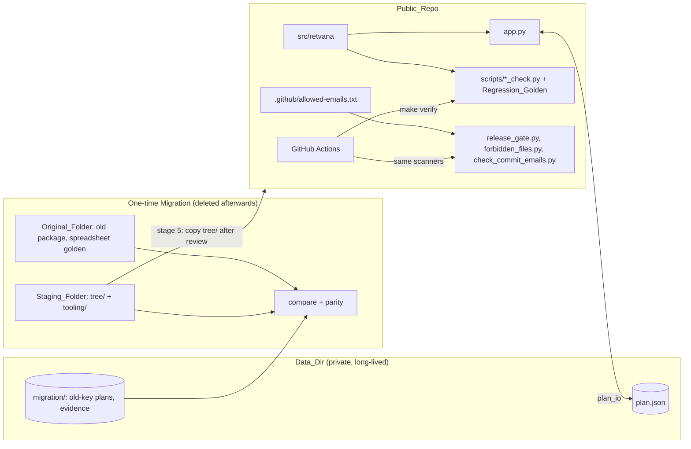

# Design: Open-source release (Spec A)

## Overview

This design moves the engine, the app and the checks from the Original_Folder into the Public_Repo as the
`retvana` package. It changes names, labels and the default plan data, and nothing in the model's rules
(Requirement 1.6). It adds plan loading from a private Data_Dir, the leak guards, and the docs and GitHub
configuration a public project needs.

The move is a one-time Migration. It is done in a temporary Staging_Folder outside the Public_Repo, in
stages, with a comparison against the old package and the spreadsheet parity check after each stage. Only
the final, de-identified tree is copied into the Public_Repo, and only after the Leak_Scan passes on it
and the author's De-identification_Review finds nothing. Nothing with personal data is ever written into
the Public_Repo, so its history can never contain it.

Leak prevention rests on structure and generic scanners, not on a list of private terms: an allowlisted
tree on a fresh root commit, `.gitignore` rules, the Forbidden_File_Check, gitleaks and the
Commit_Email_Check, plus the manual De-identification_Review at stages 4 and 5.

After the final stage passes there is no permanent private workspace. The only long-lived private data is
the Data_Dir and its working plan. The Original_Folder may then be deleted, and the public
Regression_Golden becomes the behaviour guard.

This document is itself in the Public_Repo. It names private things only generically: "the original
private folder", "the old package", "the original spreadsheet", "the old initials".



## Architecture

### Public_Repo layout

```
retvana/
├── pyproject.toml              package, Python version, exact pins (runtime + dev extras)
├── src/retvana/
│   ├── __init__.py
│   ├── config.py               Plan dataclasses, RRIF factors, example_plan()
│   ├── property_model.py
│   ├── engine.py
│   ├── vector.py
│   ├── analysis.py
│   ├── export.py
│   └── plan_io.py              new: Data_Dir resolution, load with fallback, save
├── app.py                      Streamlit entry point
├── scripts/
│   ├── verify.py               Verify_Runner
│   ├── *_check.py              model checks, rebased on the Example_Plan
│   ├── regression_check.py     new: engine vs Regression_Golden
│   ├── regression_golden.json  new: generated, never written by a check
│   ├── make_regression_golden.py   new: the generator (not run by verify)
│   ├── smoke_test.py
│   ├── forbidden_files.py      new: Forbidden_File_Check
│   ├── check_commit_emails.py  new: Commit_Email_Check
│   └── release_gate.py         new: Release_Gate, also the pre-push hook
├── examples/example_household.json
├── docs/
│   ├── assumptions.md
│   └── images/app-overview.png
├── .github/
│   ├── allowed-emails.txt      Allowed_Email_List (public)
│   ├── workflows/ci.yml
│   ├── workflows/release.yml
│   ├── ISSUE_TEMPLATE/{bug_report.yml, feature_request.yml, config.yml}
│   ├── PULL_REQUEST_TEMPLATE.md
│   └── dependabot.yml
├── .kiro/
│   ├── steering/{product.md, tech.md, structure.md}
│   └── specs/{engine-baseline/, open-source-release/}
├── .streamlit/config.toml
├── .pre-commit-config.yaml
├── .gitleaks.toml
├── .binary-allow               Binary_Allowlist: paths allowed to be binary (docs/images/*.png)
├── Dockerfile, docker-compose.yml, .dockerignore
├── Makefile
├── .gitignore
├── README.md, CONTRIBUTING.md, SECURITY.md, CODE_OF_CONDUCT.md, CHANGELOG.md
└── LICENSE                     Apache-2.0 (already present)
```

**Decision: `src/` layout.** With `src/retvana/`, the checks can only import the installed package, never
a stray copy in the current directory. During the Migration the staging venv installs the staged tree in
editable mode next to the old package, and both the comparison and the checks must be sure which code
they test. The checks drop their `sys.path.insert` lines and rely on `pip install -e .`.

**Decision: `app.py` stays at the root.** Streamlit runs a file, not a module. Keeping it at the root keeps
`streamlit run app.py`, the Dockerfile and the deploy check unchanged in shape. It imports only from
`retvana`.

**Decision: `plan_io.py` is the only plan file seam.** Spec B's PlanStore replaces it behind the same
functions.

### Data_Dir layout

The Data_Dir is `RETVANA_DATA_DIR` if set and non-empty, otherwise
`platformdirs.user_data_dir('retvana', appauthor=False)` (`~/Library/Application Support/retvana/` on
macOS). It is outside every repository.

```
<Data_Dir>/
├── plan.json                   working plan in retvana keys; the App reads and writes it
├── plan.json.tmp               exists only for the moment of a save
└── migration/                  during the Migration only; may be deleted after stage 6
    ├── spreadsheet_plan.old.json   Spreadsheet_Plan: frozen spreadsheet-settings plan, old keys
    ├── app_plan.old.json           the earlier old-key plan.json, moved here at stage 0
    └── evidence/stage-<N>.txt      full comparison and parity output per stage
```

- The App and `plan_io` touch only `plan.json` and its temp file. Nothing in retvana reads `migration/`
  (Requirement 5.9).
- The evidence files may hold personal values, which is why they stay here. Only counts, maximum
  differences and PASS or FAIL go into the Migration_Record.
- The Docker mount exposes the whole Data_Dir to the container, including `migration/` while it exists.
  That is local only, and the App never reads it.

### Staging_Folder layout (temporary)

The Staging_Folder is any folder outside the Public_Repo and outside the Original_Folder. It exists from
stage 0 until stage 6, then is deleted.

```
<Staging_Folder>/
├── .venv/                      Python 3.13: tree/ installed editable with [dev], plus the old
│                               package's dependencies and the spreadsheet tools
├── tree/                       the future Public_Repo content, in the target layout
└── tooling/                    Migration_Tooling; never copied into tree/, never committed
    ├── key_mapping.py          old JSON keys and labels → retvana; old column names → new
    ├── compare_check.py        Req 5.2: old package vs staged retvana on the Migration_Plans
    ├── parity_check.py         Req 5.3: Spreadsheet_Plan through the mapping vs the golden master
    ├── parity_golden.json      copied unchanged from the Original_Folder, with its generator
    ├── spec_marker_check.py    Req 10.5: marker counts, private vs public baseline spec
    └── run_stage.py            runs the stage's checks, writes evidence, prints the record line
```

`compare_check.py` imports the old package by adding the original private app folder to `sys.path`, and
`retvana` from the editable install. The names differ, so both load in one process. The path is passed on
the command line and never written into `tree/`.

### Migration procedure

#### Allowlist

Sources are relative to the original private app folder; `<old_pkg>` is the old package directory.

| Source | Destination | Action |
|---|---|---|
| `<old_pkg>/__init__.py` | `src/retvana/__init__.py` | copy + de-identify |
| `<old_pkg>/config.py` | `src/retvana/config.py` | rewrite (`example_plan()`, field renames, generic defaults) |
| `<old_pkg>/property_model.py` | `src/retvana/property_model.py` | copy |
| `<old_pkg>/engine.py` | `src/retvana/engine.py` | copy + de-identify (keys, labels, option names) |
| `<old_pkg>/vector.py` | `src/retvana/vector.py` | copy + de-identify |
| `<old_pkg>/analysis.py` | `src/retvana/analysis.py` | copy + de-identify |
| `<old_pkg>/export.py` | `src/retvana/export.py` | copy + de-identify |
| `app.py` | `app.py` | copy + de-identify; Data_Dir loading added |
| `scripts/verify.py` | `scripts/verify.py` | copy (docstring path updated) |
| `scripts/{benefits,consulting,corp,export,market,plan,projection,property,spending,survivor,tax,vector}_check.py` | `scripts/` same names | copy + de-identify, rebased on the Example_Plan |
| `scripts/deploy_check.py` | `scripts/deploy_check.py` | copy + de-identify; checks the new mount and env |
| `scripts/smoke_test.py` | `scripts/smoke_test.py` | copy + de-identify |
| `Dockerfile`, `docker-compose.yml`, `.dockerignore` | same | rewrite (names, `src/` install, data mount) |
| `Makefile` | `Makefile` | rewrite (names, `PYTHON` variable, new targets) |
| `.streamlit/config.toml` | same | copy |
| `requirements.txt`, `requirements-dev.txt` | `pyproject.toml` | rewrite; source files excluded |
| private baseline spec | `.kiro/specs/engine-baseline/` | rewrite |
| `scripts/parity_check.py`, the spreadsheet golden master and its generator | Staging_Folder `tooling/` | exclude from the Public_Repo |
| `scripts/*_report.py`, cross-check and repro scripts | — | exclude |
| screenshot scripts | — | exclude (the README image is captured by hand) |
| `backlog.md`, `data/`, `.venv/` | — | exclude |
| the original private folder's root: spreadsheets, AppleScripts, ad-hoc scripts, text files | — | exclude |

New files (pyproject, `plan_io.py`, regression golden and check, scanners, Release_Gate, allowed-emails
list, docs, `.github/`, steering, pre-commit and gitleaks config) are written fresh and reviewed like any
other file.

#### Stages

Each stage ends with `tooling/run_stage.py <N>`. A stage passes only when the comparison check, the
Parity_Check and every staged check in `tree/` pass (Req 5.2–5.4). The full output goes to
`<Data_Dir>/migration/evidence/stage-<N>.txt`, and one record line per stage goes into the Migration_Record
(see below). A failing stage is fixed and re-run; the next stage never starts on a failure.

0. **Prepare.** Create the Staging_Folder and its venv. Move the existing old-key `<Data_Dir>/plan.json`
   to `<Data_Dir>/migration/app_plan.old.json` before any retvana code runs, so it is never read as a
   working plan (Req 5.6). Export the old `default_plan()` once to
   `<Data_Dir>/migration/spreadsheet_plan.old.json`. Copy the parity check and the spreadsheet golden
   master into `tooling/`. Run the old package's own checks and the
   Parity_Check on the old package as the baseline.
1. **Package rename only.** Copy the allowlisted files into `tree/` in the target layout and rename the
   import to `retvana`. No other change. The comparison runs both packages on both Migration_Plans and
   requires identical results: every projection column equal, the vector engine equal, the summaries
   equal. The Parity_Check passes.
2. **Key, field and label rename.** Rename the person keys, the per-person mnemonic columns, the person-
   and employer-specific field names and the property labels (see Data Models). `default_plan()` still
   holds the private data. `key_mapping.py` is written now. The comparison runs the old package on each
   old-key plan and `retvana` on the mapped plan, comparing through the column map within $0.01 for the
   projection and 1e-9 relative for the vector engine. The Parity_Check passes through the mapping.
3. **Example plan.** Replace `default_plan()` with `example_plan()` and set generic dataclass defaults.
   Rebase the checks on the Example_Plan, write the regression generator and generate the
   Regression_Golden. From now on the comparison and parity checks read only the Migration_Plans, never
   code.
4. **Text de-identification.** Rewrite comments, docstrings, App and export labels, and write the docs,
   steering files, public baseline spec, CI and templates. Run `spec_marker_check.py` (Req 10.5). Run
   `forbidden_files.py --dir tree` and `gitleaks dir tree` until both report zero findings. Then the
   author does the De-identification_Review of every file in `tree/` against the Identifier_Checklist
   (Req 6.13); any finding is rewritten and the review repeated (Req 6.14).
5. **Publish.** Copy `tree/` into the Public_Repo working tree, on a `migration` branch on top of the
   initial commit, in a few topical commits (package, checks, app and deploy, docs, GitHub config). Set
   the Maintainer_Flag and install the hooks; every commit passes them. Run the Release_Gate. Before the
   first push, the author does the De-identification_Review of the full branch diff against the initial
   commit, including commit messages (Req 6.13). Push the
   branch (the pre-push hook runs the Release_Gate again) and open a pull request; CI runs every job
   because the branch is in the Public_Repo. Merge, then turn on the branch ruleset.
6. **Close.** In the staging venv, replace the editable install of `tree/` with an editable install of the
   Public_Repo at the merged main, and run the comparison and the Parity_Check once more, so the
   published code itself is proved. Convert `migration/app_plan.old.json` through the mapping and write
   it to `<Data_Dir>/plan.json` (Req 5.7). Start the App and confirm it loads that plan without a warning.
   Record the result, then delete the Staging_Folder.

After stage 6 passes:

- The Original_Folder may be deleted. Archiving the original spreadsheets somewhere outside any
  repository first is recommended; that is the author's choice, and nothing in retvana depends on them
  (Req 5.9).
- `<Data_Dir>/migration/` may be deleted. From then on the Regression_Golden guards behaviour.

#### Migration_Record

`tasks.md` of this spec gets a section headed "Migration record". One line per stage run:

```
Stage 2 | PASS | projection cols compared 2 plans × 74 cols × 40 yrs, max diff $0.00 | vector max rel 0.0 | parity 8/8 cases PASS | staged checks 15/15 PASS
```

Only counts, maximum differences and PASS or FAIL are written. `run_stage.py` builds the line from the
evidence and refuses to print any value that is not a count, a difference or a status, so no balance or
name can reach the public file. That guard is the control for Req 5.8.

## Data Models

The plan schema is unchanged apart from the renames below. The other formats this spec adds are described
with their components: the Regression_Golden under Testing Strategy, and the Binary_Allowlist and the
Allowed_Email_List under Components and Interfaces.

### Person keys

The old person keys are one-letter initials. They are replaced by `P1` and `P2`. Person 1 is the person
whose accounts sit in the first per-person block of the original spreadsheet (columns `F` to `R`), and
Person 2 the second block (`S` to `AE`), so the column mapping is unchanged.

The engine uses the spreadsheet's column letters as row keys, and two of those letters are the same as the
old initials. The rename therefore cannot be a text substitution. It touches only these uses:

| Use | Today | After |
|---|---|---|
| Person and owner keys | `Person.key`, `Account.owner`, `ConsultingIncome.owner`, `plan.person(k)`, `death_year(k)`, schedule dicts keyed by person | `'P1'`, `'P2'` |
| Per-person mnemonic columns | `age_<k>`, `T<k>`, `W<k>`, `CPP<k>`, `D<k>` | `age_P1`, `T_P1`, `W_P1`, `CPP_P1`, `D_P1` and the same for P2 |
| Starting-position fields | `nonreg_<k>`, `reg_<k>`, `tfsa_<k>` | `nonreg_p1`, `reg_p1`, `tfsa_p1`, … |
| Local variables | `alive<k>`, `working_<k>`, `base_<k>`, `ok_<k>`, single-letter person variables | `alive1`, `working1`, `base1`, `ok1`, `p1`, … |
| Person-specific plan fields | a base non-registered balance and a shareholder switch named after people | `base_nonreg_p2`, `p1_shareholder` |
| Display names | static names in `engine.COLUMNS`, summary keys | "Person 1 …" / "Person 2 …", with the App and export substituting the plan's names |

The `_P1` suffix, not a bare `1`, avoids a clash with `CPP2`, which already means the second additional
CPP contribution. Spreadsheet letters (`F`, `I`, `S`, `V`, `BU`, `BX`, `L`, `B`, …) and `Qc`/`ADc` stay as they
are.

Display names: `engine.COLUMNS` keeps generic labels, and a helper `column_label(key, plan)` replaces
"Person 1"/"Person 2" with the plan's names for the App and the export. Summary keys stay generic
("Person 2 CPP at 65"), because `export_check` compares them.

The migration mapping (`tooling/key_mapping.py`) covers the person keys, the renamed plan fields, the
property names and the column names, because `Plan.from_dict` drops unknown keys silently and an unmapped
old plan would load with fields missing. It is used in stages 2 to 6 and deleted with the Staging_Folder.

### Property labels and option names

- Properties are named "Property 1", "Property 2", "Property 3", with an empty `description`. Mortgage
  names follow ("Mortgage on Property 3"). The `Townhouse.areas` default is empty.
- Option fields lose the employer prefix: `option_grants`, `options_share_price`,
  `options_marginal_rate`, and `engine.options_net_proceeds()`. App, export and docs say "employee stock
  options". The options still belong to Person 1. This is an existing rule, recorded as **(inherited)** in
  the public baseline spec, not a new owner field.
- Expense items and segment rationales are reworded generically: no city, district or building names.

### The example household

`example_plan()` returns a synthetic household with round values chosen for this repo. No value is taken
from the Private_Plan.

| Item | Example_Plan |
|---|---|
| People | P1 "Alex", born 1975, CPP estimate $1,100/month, death age 92; P2 "Sam", born 1980, $1,300/month, death age 96 |
| Timeline | current year 2026, retirement 2032 |
| P1 accounts | RRSP $600,000 (contribution $6,000), LIRA $50,000, TFSA $120,000 (TFSA limit contributions) |
| P2 accounts | RRSP $300,000, LIRA $400,000, DC pension $150,000 (contribution $18,000), TFSA $120,000 |
| Non-registered | P2 base $150,000 plus the sale surplus split |
| Options (P1) | three grants of 10,000 / 10,000 / 5,000 at $1, $2, $3, all expiring after retirement; share price $4 |
| Properties | Property 1: principal residence, condo townhouse, $750,000 today; Property 2: rental studio, $350,000, ACB set; Property 3: rental condo apartment, $500,000, ACB left as purchase price |
| Mortgages | $450,000 on Property 3; $180,000 secured on Property 1 (a mortgage registered on another property) |
| Townhouse | $1,050,000 today, follows the market |
| Expenses | about ten generic items, three discretionary with lower later-phase amounts |
| Consulting | none in the example; added by the regression cases |

The values are tuned at implementation time so that every feature path is reached somewhere in the
regression cases, and the generator asserts each one:

- both RRIF start rules (`minimums` from retirement; `defer` to the conversion age);
- the LIRA unlock (P2 is 52 at retirement and reaches 55 in 2035);
- the survivor rules (death ages on);
- OAS clawback rows with a non-zero clawback;
- a negative surplus (Bear) and a positive surplus (Bull with a fixed townhouse);
- an extra registered draw and a TFSA draw in the cascade.

`examples/example_household.json` is `example_plan().to_json()`. A check compares the two (Req 8.7).

## Components and Interfaces

### Plan loading

`src/retvana/plan_io.py` is the only code that touches the plan file.

```python
def data_dir() -> Path:
    """RETVANA_DATA_DIR if set and non-empty, else platformdirs.user_data_dir('retvana', appauthor=False)."""

@dataclass
class LoadResult:
    path: Path
    plan: Plan | None        # None when missing or unreadable
    error: str | None        # "<ExceptionType>: <message>" when unreadable

def load_saved_plan(directory: Path) -> LoadResult: ...
def save_plan(plan: Plan, directory: Path) -> Path: ...
```

- **Resolution.** The App resolves `data_dir()` once per session.
- **Read or parse failure.** Any `OSError`, `UnicodeDecodeError`, `json.JSONDecodeError`, `TypeError` or
  `ValueError` from reading and `Plan.from_json`. A plan whose person keys are not exactly `P1` and `P2` is
  also unreadable, because every projection would fail on it (this also catches an unconverted old-key
  plan).
- **App start.** Missing file: `fresh_plan()` from the Example_Plan. Unreadable file: `fresh_plan()`, plus
  `st.warning` naming the path and the error. "Save as default" is disabled while the error stands, with
  the reason shown as its help text (Req 7.9). The file is never touched.
- **Save.** `save_plan` creates the directory, then re-reads any existing `plan.json`. If that file is now
  unreadable it raises `PlanFileUnreadable` and writes nothing (Req 7.8 holds even if the file broke
  after start). Otherwise it writes `plan.json.tmp` and `os.replace`s it, so a crash cannot leave a half
  file.
- **Docker.** The compose service mounts `${RETVANA_HOST_DATA_DIR:?…}` at `/data` and sets
  `RETVANA_DATA_DIR=/data`. The Makefile sets `RETVANA_HOST_DATA_DIR` from the host's platformdirs path
  when it is unset, so the local App and the container share one plan. The read-only root filesystem,
  the dropped capabilities and the `127.0.0.1` port binding stay as they are.
- The download button's file name becomes `retvana_plan.json`.

### Leak prevention design

#### Maintainer_Flag

A clone is a Maintainer_Clone when its own git config has `retvana.maintainer=true`:

```
git config --local retvana.maintainer true      # set once per clone
git config --type=bool --get retvana.maintainer  # what the pre-push hook reads
```

**Decision: a local git config key.** It lives in `.git/config`, so it is per clone and is never pushed,
cloned or tracked. The pre-push hook already runs inside git, so it works the same from a terminal or an
IDE, where environment variables from a shell profile are often missing. It names no path, so nothing points
at a private folder. It is one documented command to set and `git config --unset` to clear. A marker file
under `.git/info/` would do the same job with a custom format; an environment variable would not reach
IDE commits reliably.

The flag decides only whether the pre-push hook runs the Release_Gate (Req 6.7–6.8). No scanner reads it,
and no scanner behaves differently between clones.

#### Forbidden_File_Check: `scripts/forbidden_files.py`

The check uses only the standard library and no private data, so it runs the same in every clone, in
Fork_PRs and in the Release_Gate. Modes:

- `--files F…`: the given files (pre-commit);
- `--tree`: tracked files plus untracked files that are not ignored;
- `--dir PATH`: every file under a directory that is not a git repo, skipping `.git/` and `.venv/`
  (Migration stage 4);
- `--history`: every blob reachable from any ref, with the path it was committed under, so a forbidden
  file that was committed and later deleted is still found.

Rules (Req 6.4):

- extensions `.xlsx .xls .xlsm .xlsb .ods .csv .ipynb .pdf .doc .docx .ppt .pptx .zip .pkl .parquet .db
  .sqlite`, which are never allowed;
- any file that is not valid UTF-8 or contains a NUL byte, unless its path matches a pattern in the
  Binary_Allowlist `.binary-allow` (only `docs/images/*.png`);
- an allowed PNG that carries `tEXt`, `iTXt`, `zTXt` or `eXIf` chunks, since metadata can hold names or
  paths. Images cannot be text-scanned, so the PR template asks for a visual review.

Output on a finding is `path: forbidden file (<rule>)`, or `commit:path: …` in history mode, where
`<rule>` is `extension`, `binary` or `png metadata`. The check never prints file content and writes
nothing to disk. Any finding exits 1 (Req 6.3).

#### De-identification review

No scanner can recognise the author's personal details without a list of them, and this design keeps no
such list. The De-identification_Review is therefore a manual step by the author, done twice during the
Migration (Req 6.13):

- at stage 4, over every file in `tree/`, including the regression golden, the example JSON and the PNG;
- at stage 5, over the full `migration` branch diff against the initial commit, including every commit
  message, before the first push.

The author goes through the Identifier_Checklist category by category and records only "done" on the
task. A finding is rewritten (text) or changed (example value, which is a spec change and regenerates the
golden), and the review is repeated (Req 6.14).

**Identifier_Checklist** (categories only; it never holds an actual value, Req 6.15):

1. household member names, including nicknames and initials used as keys or labels;
2. birth years, or ages tied to a person;
3. property, street, building, neighbourhood, district and city names tied to the household;
4. employer names, stock-grant and plan names, and employer-specific terms;
5. names of the old package, the original spreadsheet, any workbook and the Original_Folder, and any
   local path;
6. the author's email addresses and numeric GitHub account id;
7. distinctive figures from the Private_Plan or the original spreadsheet: balances, prices, mortgage
   amounts, pension estimates, and any figure with cents or five or more significant digits that is not a
   round example value or a public rate.

CONTRIBUTING's maintainer notes point to this section (Req 8.3).

#### Commit emails: `scripts/check_commit_emails.py`

- The Allowed_Email_List is `.github/allowed-emails.txt`, committed and public. It holds one `fnmatch`
  pattern per line, case-insensitive:

  ```
  *@users.noreply.github.com
  noreply@github.com
  ```

  The second covers commits GitHub makes itself (web-flow and squash merges).
- Because the list is public, the check is strict everywhere: every clone, every CI trigger, Fork_PRs
  included. No secret or flag is involved.
- Modes: `--pending` (pre-commit; reads `git var GIT_AUTHOR_IDENT` and `GIT_COMMITTER_IDENT`) and `--all`
  (every commit reachable from any ref). `--allowed PATH` overrides the list for tests.
- A failure prints `<hash>: author email not allowed` or `committer email not allowed`, never the email
  itself (Req 6.11). A missing or empty list file exits 2 naming the path.

#### Release_Gate: `scripts/release_gate.py`

`release_gate.py [--pre-push]` runs these steps from the clone's root and exits non-zero if any fails:

1. `gitleaks git --log-opts=--all` (history) and `gitleaks dir .` (working tree), using the repo's
   `.gitleaks.toml`. A missing `gitleaks` binary fails the step; CONTRIBUTING names the pinned version.
2. `forbidden_files.py --tree --history`.
3. `check_commit_emails.py --all`.
4. A summary of one line per step, PASS or FAIL.

With `--pre-push` (the hook) in a Contributor_Clone, it prints `release gate skipped: not a maintainer
clone` and exits 0 (Req 6.8); contributors are covered by the pre-commit hooks and CI. In a
Maintainer_Clone, the hook runs every step (Req 6.7, 6.9). Run by hand, without `--pre-push`, it always
runs every step.

#### `.pre-commit-config.yaml`

```yaml
default_install_hook_types: [pre-commit, pre-push]
repos:
  - repo: https://github.com/gitleaks/gitleaks
    rev: <pinned tag>
    hooks: [{id: gitleaks}]
  - repo: local
    hooks:
      - {id: forbidden-files, name: forbidden file check,
         entry: python scripts/forbidden_files.py --files, language: python, types: [file]}
      - {id: commit-email, entry: python scripts/check_commit_emails.py --pending,
         language: python, pass_filenames: false, always_run: true}
      - {id: release-gate, entry: python scripts/release_gate.py --pre-push,
         language: python, pass_filenames: false, always_run: true, stages: [pre-push]}
```

`types: [file]` includes binary files, so the forbidden-file rules see them. The local hooks use only the
standard library, so they need no `additional_dependencies`.

#### CI workflows

`ci.yml` triggers on `push` to main, `pull_request` to main, `workflow_dispatch` and `workflow_call`. The
workflow has `permissions: contents: read`. Every action is pinned to a commit SHA, and checkout uses
`persist-credentials: false` and full history.

| Job | Runs on | Steps |
|---|---|---|
| `verify` | every trigger, forks included | Python 3.13, `pip install -e .[dev]`, `make verify PYTHON=python` |
| `gitleaks` | every trigger, forks included | pinned gitleaks binary, checksum verified; `gitleaks git --log-opts=--all` and `gitleaks dir .` |
| `commit-emails` | every trigger, forks included | `check_commit_emails.py --all` |
| `forbidden-files` | every trigger, forks included | `forbidden_files.py --tree --history` |

- On pull requests, the scanning jobs (`gitleaks`, `commit-emails`, `forbidden-files`) check out the PR
  head commit, not GitHub's synthetic merge commit, so only real commits are checked. They run the scanner
  scripts and `.gitleaks.toml` from a second checkout of the base commit, so a pull request cannot weaken
  the scanner that judges it.
- `pull_request_target` is never used, so fork code never runs with write permissions.

`release.yml` triggers on tags `v*`. It calls `ci.yml`, then a `release` job (`needs:` all four,
`permissions: contents: write`) creates the GitHub release from the CHANGELOG entry. No release exists
unless the full scans passed (Req 6.2, 6.12, "before each release").

Secrets: none. Every job runs the same way for internal pull requests, Fork_PRs and Dependabot pull
requests, so no repository or Dependabot secret is needed.

### GitHub configuration

- **Workflows:** `ci.yml` and `release.yml` as above.
- **Dependabot** (`dependabot.yml`): ecosystems `pip` (reads `pyproject.toml`), `github-actions` and
  `docker` (base image digest), checked weekly, with minor and patch updates grouped. pre-commit hook revs
  are bumped with `pre-commit autoupdate` by the maintainer, unless Dependabot's pre-commit support is
  available at implementation time.
- **Templates:** bug report and feature request issue forms; `config.yml` turns off blank issues and links
  security reports to private reporting. The PR template is a checklist: spec changed (which), `make verify`
  passed, golden regenerated (and the spec change that justifies it), no personal data, images reviewed.
- **Branch ruleset on main:** require a pull request (0 approvals, single maintainer); require status checks
  `verify`, `gitleaks`, `commit-emails`, `forbidden-files`, with the branch up to date; block force pushes and
  deletion; linear history; squash merge only; no bypass.
- **Security settings:** secret scanning and push protection on; private vulnerability reporting on;
  Dependabot alerts and security updates on; default `GITHUB_TOKEN` permission read-only; approval needed
  before workflows run for outside contributors.
- **Account settings (author):** "Keep my email addresses private" and "Block command line pushes that
  expose my email". GitHub then rejects a push with a private email server-side, a layer behind the hook
  and CI.

### Docs and Kiro files

- **README.md:** name and one-line purpose; the "not financial advice" disclaimer at the top; the
  screenshot; what it models (two-person Canadian household, 2026 Ontario tax rules); quick start, local
  (`pip install -e .[dev]`, `make run`) and Docker (`make up`); where plans are saved (Data_Dir,
  `RETVANA_DATA_DIR`); `make verify`; links to docs, contributing and security; licence.
- **Screenshot:** captured by hand from the App running the Example_Plan, saved as
  `docs/images/app-overview.png`, stripped of metadata (the scanner enforces this) and reviewed by eye.
  There is no screenshot script.
- **CONTRIBUTING.md** pulls the human rules into one place:
  - a behaviour change starts with a spec change;
  - checks are never adjusted to fit the code;
  - a golden master is never regenerated to make a check pass; fix the code or update the spec;
  - `make verify` must pass;
  - install the hooks with `pre-commit install`;
  - commit with your GitHub noreply address (`git config user.email <id>+<user>@users.noreply.github.com`),
    and turn on "Keep my email addresses private" (GitHub Settings → Emails) so web-flow and squash
    merge commits use it too;
  - if `commit-emails` fails on your pull request, re-author your own commits with the noreply address
    (for example `git rebase -r <base> --exec 'git commit --amend --no-edit --reset-author'`, then
    `git push --force-with-lease` to your branch). The maintainer does not re-author contributor
    commits (Req 8.8);
  - no personal data in issues, PRs or example plans.

  Maintainer notes: set the Maintainer_Flag; do a De-identification_Review of your own diff and commit
  messages against the Identifier_Checklist (linked to the "De-identification review" section of this
  spec's design, never copied with values) before pushing new docs or example changes; install the pinned
  gitleaks binary; run `python scripts/release_gate.py`; push nothing to the Public_Repo until the
  Release_Gate passes (Req 8.3).
- **SECURITY.md:** report through GitHub private vulnerability reporting; supported version (latest); the
  App has no login and binds to localhost by design, so do not expose it on a network. No email address.
- **CODE_OF_CONDUCT.md:** Contributor Covenant 2.1. The enforcement section points people first to
  GitHub's "Report content" feature on the offending comment, issue or pull request, and second to
  GitHub private vulnerability reporting on this repository as a private route to the maintainer
  (Req 8.5). No email address.
- **CHANGELOG.md:** Keep a Changelog format, `0.1.0` as the first entry.
- **docs/assumptions.md:** tax year and province; each rule marked (inherited), (simplification) or
  (limitation) in the public baseline spec, with its requirement number; the pre-2015 RRIF factor table;
  what is not modelled.
- **Steering:** `product.md` (what retvana is, who it is for, scope and non-goals, no personal data
  anywhere); `tech.md` (Python 3.13, the stack, exact pins, `make verify`, plain-script checks, the hand
  calculation and golden rules); `structure.md` (layout, module responsibilities, dependency direction,
  where checks live).
- **Public baseline spec:** `requirements.md`, `design.md` and `tasks.md` rewritten under
  `.kiro/specs/engine-baseline/` with a new spec id. The rewrite uses the new keys, fields and paths;
  restates any figure that came from the private plan against the Example_Plan, or generically; calls the
  spreadsheet "the original spreadsheet"; and describes the spreadsheet parity check as a one-time
  Migration check that is not part of this repository. Every rule and marker is kept. The marker counts
  are compared once at stage 4 by `tooling/spec_marker_check.py` (Req 10.5); the private baseline spec is
  read from the Original_Folder and the comparison is not kept.

## Error Handling

| Situation | Behaviour |
|---|---|
| `plan.json` missing | Start from the Example_Plan with app defaults; no message |
| `plan.json` unreadable or unparsable, or wrong person keys | Start from the Example_Plan; `st.warning` with the path and `<ExceptionType>: <message>`; "Save as default" disabled with the reason; file untouched |
| Existing `plan.json` unreadable at save time | `PlanFileUnreadable`; the App shows the warning; nothing written |
| Write fails (permissions, disk) | `OSError` shown as an error in the sidebar; the temp file is removed; the old file stays |
| Forbidden file found | Exit 1, `path: forbidden file (<rule>)`; no file content; blocks the commit, push or CI job |
| gitleaks finding | gitleaks exits non-zero; blocks the commit, push or CI job |
| Allowed_Email_List file missing or empty | Exit 2, naming the path |
| Commit email not allowed | Exit 1, `<hash>: author/committer email not allowed` |
| Fork_PR in CI | Every job runs as for any other pull request; no secret is involved |
| De-identification_Review finds a Personal_Identifier | The Migration stays at the stage; the text or example value is rewritten and the review repeated |
| `gitleaks` binary missing in the Release_Gate | That step fails; the gate exits non-zero |
| Release_Gate step fails | Non-zero exit; the pre-push hook blocks the push |
| Pre-push in a Contributor_Clone | Notice, exit 0 |
| Example plan changed without regenerating the golden | `regression_check` fails on the plan hash with the regeneration instruction |
| Feature coverage lost when generating the golden | The generator exits non-zero and writes nothing |
| Migration comparison or parity fails at a stage | `run_stage.py` exits non-zero, records FAIL; the next stage does not start |
| `run_stage.py` record line would hold a non-count value | It exits non-zero and prints no record line |

## Testing Strategy

The checks stay plain scripts run by the Verify_Runner. Each prints PASS/FAIL lines and exits non-zero on
failure. This spec rebases the existing checks, adds a regression golden and adds checks for the new code.
The Migration_Tooling checks run only during the Migration and are not part of `make verify`.

### Hand checks

Each hand check reads its inputs from the plan and writes out only the rule:

```python
p = example_plan()
prop = p.properties[1]                        # the rental with ACB set
gain = prop.value_today - prop.acb            # rule written out, inputs read from the plan
expected_cgt = gain * p.cg_inclusion * p.tax_rates[-1]
```

- Literal private figures are replaced with reads from `example_plan()` or a small plan built in the check.
- Constants that are public rules (tax thresholds, OAS amounts, RRIF factors, LTT brackets) stay literal,
  as they are today.
- Checks that select "the rental" or "Person 2" use the generic keys and indexes, not names.
- `fresh_plan()` mirrors stay, built on `example_plan()`; `plan_check` keeps the mirror honest.
- Any expected value that only held for the private data is re-derived from the rule, never from the
  function under test (Requirement 4.2). Where a check asserted a qualitative outcome that depended on
  the private data (for example "the money lasts"), the example values are chosen so the outcome holds,
  and the check says so.

### Regression golden

`make_regression_golden.py` runs `engine.project` on the Example_Plan for 12 cases and writes
`regression_golden.json`. The first 8 keep the shape of the spreadsheet parity cases (retirement year ×
property scenario × switches). The other 4 cover the switches that the parity cases leave at their
defaults.

| # | Case |
|---|---|
| 1 | 2032 Base |
| 2 | 2029 Base |
| 3 | 2031 Bear (negative surplus) |
| 4 | 2035 Boom |
| 5 | 2030 Bull, income splitting |
| 6 | 2032 Base, CPP 60/70 and OAS 70/67 |
| 7 | 2029 Bull, fixed townhouse (positive surplus) |
| 8 | 2027 Base |
| 9 | 2032 `defer`, death ages on (survivor) |
| 10 | 2032 `bracket` with a target above the OAS threshold, TFSA top-up, accurate extra tax |
| 11 | 2032 recovery mode, median path, app defaults |
| 12 | 2032 consulting: P1 direct, P2 through the corporation |

Format (sorted keys, one year per line for readable diffs):

```json
{
  "schema": 1,
  "generator": "scripts/make_regression_golden.py",
  "example_plan_sha256": "…",
  "tolerance": {"dollars": 0.01, "other": 1e-9},
  "cases": [
    {"name": "2032 Base", "overrides": {"start_year": 2032, "legacy_scenario": "Base"},
     "rows": {"2032": {"B": 123456.78, "C": 0.0}}}
  ]
}
```

- Every column of `engine.project` is stored. Dollar columns are rounded to cents. Ratio, rate and age
  columns are stored unrounded and compared at 1e-9.
- `regression_check.py` opens the golden read-only and writes nothing (Req 4.6). It compares each case
  within the stored tolerances and reports the first differing cells per case. It checks the column set
  both ways.
- If the hash of `example_plan().to_json()` differs from `example_plan_sha256`, the check fails with
  "example plan changed: update the spec, then regenerate the golden deliberately". That catches an
  example edit made without a deliberate regeneration.
- The generator also writes nothing unless every feature-coverage assertion above holds.
- After the Migration this golden is the only behaviour guard, so it covers every column and every
  feature path the spreadsheet parity cases did.

### What `make verify` runs

`scripts/verify.py` runs every `scripts/*_check.py` in name order, then `smoke_test.py`. It never runs
`make_regression_golden.py` or `release_gate.py`, and the name pattern cannot match them. The new checks
are:

| Check | Covers |
|---|---|
| `regression_check.py` | Req 4.4–4.6 |
| `examples_check.py` | Req 8.7 |
| `plan_io_check.py` | Req 7.1–7.5, 7.7–7.9, using temp dirs and env overrides |
| `forbidden_files_check.py` | the Forbidden_File_Check in a temp repo: every forbidden extension, non-UTF-8 and NUL files, Binary_Allowlist patterns, PNGs with and without each metadata chunk, the `--files`, `--tree`, `--dir` and `--history` modes (a forbidden file committed and then deleted is still reported), output never contains file content, exit codes |
| `commit_email_check.py` | the email checker against a temp repo with allowed and disallowed identities; the committed list holds exactly the two patterns |
| `release_gate_check.py` | the gate in a temp repo with stub `gitleaks`: a stub gitleaks finding, a forbidden file in history and a bad email each give a non-zero exit; a missing `gitleaks` fails its step; `--pre-push` without the Maintainer_Flag skips with the notice; with the flag it runs every step |
| `repo_check.py` | no `requirements*.txt`, every pyproject dependency pinned with `==`, `.gitignore` entries present, person keys of the Example_Plan are exactly `P1`/`P2`, no tracked forbidden file types, required docs and steering files present |

`make verify` uses `PYTHON ?= .venv/bin/python`, so CI runs `make verify PYTHON=python`.

### Migration checks (one-time, Staging_Folder only)

| Check | Covers |
|---|---|
| `tooling/compare_check.py` | Req 1.1, 1.6, 5.2 |
| `tooling/parity_check.py` | Req 1.6, 5.3 |
| `tooling/spec_marker_check.py` | Req 10.5 |
| `tooling/run_stage.py` | Req 5.4, 5.8 |

### Why no property-based tests in this spec

This spec renames, moves and configures; it adds no model logic. The model's invariants (P1 to P6) are
already checked by the baseline checks, which move over unchanged in substance. The new logic is small
and has a fixed set of interesting cases: the Data_Dir order, the fallback, the forbidden-file rules, the
pre-push switch and the email patterns. Example-based checks cover those cases, and the stage-by-stage
comparison proves the rename against the old package on the real plans. A property-based library would
also be a new dependency for little gain, so the Correctness Properties section is omitted.

### Verification

| Req | How it is checked |
|---|---|
| 1.1 | Migration comparison, stage 1 (identical results); manual review of the module list |
| 1.2–1.3 | `repo_check.py` |
| 1.4 | `deploy_check.py` (image, service, user names); manual review of Makefile targets |
| 1.5 | `src/` layout; checks have no `sys.path` edits (review); CI installs the package before `make verify` |
| 1.6 | Migration comparison and Parity_Check at every stage and at stage 6 on the published code |
| 2.1–2.3 | Allowlist table; De-identification_Review of the stage 5 diff; Forbidden_File_Check |
| 2.4 | Manual: `git log` shows the initial commit as the root; Release_Gate history scan |
| 3.1–3.5 | `repo_check.py` (person keys), `examples_check.py`; De-identification_Review (names, employer terms) |
| 3.6 | De-identification_Review at stages 4 and 5 (Req 6.13) |
| 3.7 | Leak_Scan at stage 4, in pre-commit, CI and the Release_Gate |
| 4.1–4.2 | Manual review of the rebased checks; CI has no private data to import |
| 4.3 | Allowlist; De-identification_Review of the stage 5 diff; CI runs without the private files |
| 4.4–4.6 | `regression_check.py`; `verify.py` pattern excludes the generator |
| 4.7 | CI `verify` job |
| 5.1, 5.4 | `run_stage.py`; the Migration_Record shows every stage in order with PASS |
| 5.2–5.3 | `compare_check.py`, `parity_check.py` |
| 5.5 | Manual: `tooling/` is outside `tree/`; De-identification_Review of the stage 5 diff; Staging_Folder deleted at stage 6 |
| 5.6–5.7 | Manual at stages 0 and 6; App start at stage 6 loads `plan.json` with no warning |
| 5.8 | `run_stage.py` record-line guard |
| 5.9 | `make verify` and CI pass with no Original_Folder or `migration/` present |
| 6.1 | `.pre-commit-config.yaml`; CI `gitleaks` job |
| 6.2–6.4 | `forbidden_files_check.py`; CI `forbidden-files` on internal PRs and a test fork PR |
| 6.5 | `repo_check.py` |
| 6.6–6.9 | `release_gate_check.py`; manual dry run at stage 5 with a planted forbidden file in a scratch branch |
| 6.10–6.12 | `commit_email_check.py`; CI `commit-emails` on internal and fork PRs; Release_Gate |
| 6.13–6.14 | Manual: the (author) review tasks at stages 4 and 5 are done before the stage check passes |
| 6.15 | Manual review of the Identifier_Checklist section of this design |
| 7.1–7.5, 7.7–7.9 | `plan_io_check.py`; smoke test of the App start with a broken file |
| 7.6 | `deploy_check.py` |
| 8.1–8.6 | `repo_check.py` (files present); manual review; De-identification_Review (no email address, no identifiers) |
| 8.7 | `examples_check.py` |
| 8.8 | Manual review of CONTRIBUTING; CI `commit-emails` is a required check on pull requests |
| 9.1 | Workflow review; first CI runs on the migration PR and a fork PR |
| 9.2–9.3 | File presence in `repo_check.py`; manual review |
| 9.4 | Manual: ruleset settings; a test PR that fails a check cannot merge |
| 10.1–10.2 | `repo_check.py` (files present) |
| 10.3 | Manual review; De-identification_Review |
| 10.4 | `repo_check.py` |
| 10.5 | `tooling/spec_marker_check.py` at stage 4 |

## Risks and decisions

- **Column letters kept.** The spreadsheet letters stay as engine keys. They are not personal, they keep
  the Migration's parity check a direct comparison, and renaming would be a refactor with its own spec.
  Only the per-person mnemonic suffixes change.
- **No permanent private workspace.** Once the Original_Folder is deleted, behaviour against the original
  spreadsheet can no longer be re-proved. That is accepted: stage 6 proves the published code against it
  once, and from then on the Regression_Golden guards behaviour on the Example_Plan.
- **Unconverted old plans.** An old-key plan loaded by retvana is treated as unreadable (wrong person keys)
  and falls back to the example, with a warning, and the file is kept as it is. The Migration avoids this
  for the author's plan by moving the old file first and converting it once.
- **Screenshot.** The PNG is the only binary allowed. It is captured by hand, stripped of metadata and
  reviewed by eye.
- **No list of private terms.** The design keeps no deny list. A hand-maintained list fails silently
  when an entry is missing, drifts between a local copy and CI secrets, and its false positives tempt
  weakening it, while it mostly guards a one-time Migration risk. Instead the Public_Repo relies on
  structure (the Allowlist, a fresh root commit, `.gitignore`, forbidden file types), generic scanners
  (gitleaks, the Commit_Email_Check) and the author's De-identification_Review at stages 4 and 5.
- **Accepted residual risk.** After the release, nothing automatically catches a personal term typed into
  a doc, a comment, an example value or a commit message. gitleaks catches secrets, the
  Commit_Email_Check catches private commit emails, and review (the maintainer's own diff review against
  the Identifier_Checklist, and pull request review) covers the rest. This is accepted.
- **Contributor emails.** The `commit-emails` job runs on the pull request's own commits, Fork_PRs
  included, and is a required check, so a contributor whose commits do not use a noreply address is
  stopped before merge. The contributor fixes it by re-authoring their own commits, as CONTRIBUTING
  explains; the maintainer never re-authors contributor commits. A squash merge's author email comes
  from the contributor's GitHub email setting, which no check can see before the merge exists;
  CONTRIBUTING asks contributors to turn on "Keep my email addresses private" for that reason, and the
  `commit-emails` job on the push to main reports any miss.
- **Exact pins.** Direct runtime and dev dependencies are pinned with `==` in `pyproject.toml`, with the
  same versions as today plus `platformdirs` and `pre-commit`. Transitive dependencies are not locked;
  a lock file is left to a later change. Dependabot proposes updates, and `make verify` gates them.
- **Python version.** `requires-python = ">=3.13,<3.14"`, matching the container and the pins CI tests.
- **Docker base image.** `python:3.13-slim`, pinned by digest and updated by Dependabot; non-root user
  `retvana`; `pip install .` (not editable) from `pyproject.toml`.
- **Pytest.** The checks stay plain scripts in this spec; moving to pytest is a later change.
- **Account names.** The GitHub username and display name are outside the scanner's reach; the author
  checks them before publishing.
- **Conduct reports.** "Report content" goes to GitHub and is the public-platform route; private
  vulnerability reporting is used only as the private fallback to the maintainer, because it keeps every
  email address out of the repo.
