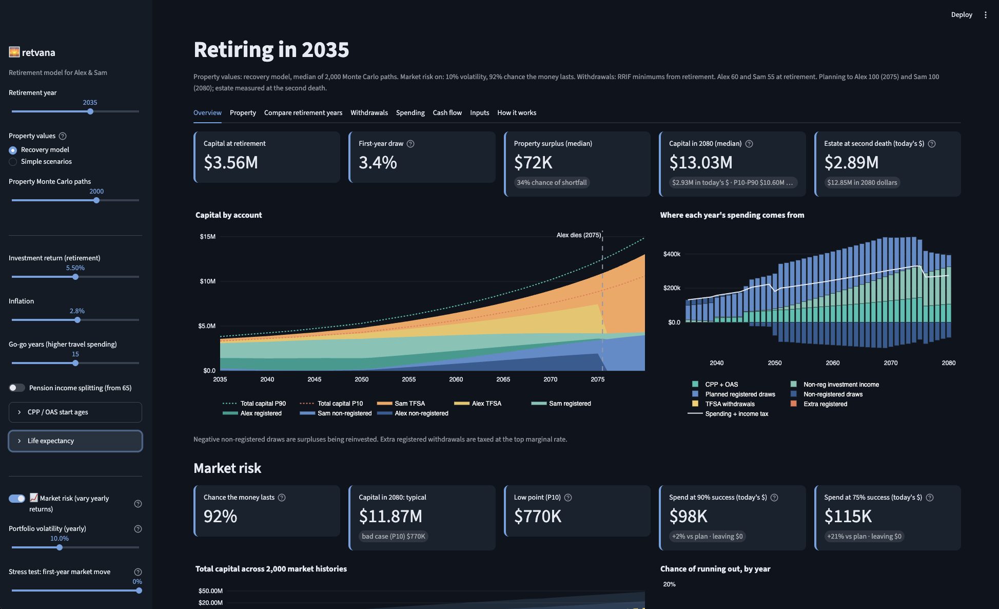

# retvana

A retirement drawdown planner for a two-person Canadian household, modelled on 2026 Ontario rules.

> **Not financial advice.** retvana is a model, not an adviser. Its results depend on assumptions that
> may not fit your situation, and tax rules change. Check important decisions with a qualified
> professional. See [docs/assumptions.md](docs/assumptions.md) for what the model does and does not do.



## What it models

retvana projects a household's accounts, taxes, benefits and property decisions year by year, from the
retirement year to the end of the plan, so you can compare retirement years, withdrawal strategies and
property scenarios side by side.

- **Tax year and province:** 2026 federal and Ontario rules (tax brackets, basic personal amount, CPP,
  OAS and the OAS clawback, TFSA limit, land transfer tax), indexed forward by inflation. Other
  provinces and other tax years are not modelled.
- **Household:** two people (Person 1 and Person 2) with RRSP/RRIF, LIRA, DC pension, TFSA and
  non-registered accounts, RRIF minimums, LIRA unlocking at 55, pension income splitting and survivor
  rules.
- **Options:** employee stock options, consulting income (direct or through a corporation), and the
  sale of the household's properties to buy a replacement townhouse.
- **Analyses:** a deterministic projection, a property Monte Carlo with a mean-reversion model, a
  market-risk Monte Carlo, a retirement-year comparison, withdrawal-strategy search and a sustainable
  spending solver.
- **Export:** a values-only Excel workbook of a scenario.

The app starts with a synthetic example household (`example_plan()`, also in
[examples/example_household.json](examples/example_household.json)). Every name and figure in it is made
up.

## Quick start

You need Python 3.13. For the Docker route you also need Docker with Docker Compose.

### Local

```bash
git clone https://github.com/brentwolfram/retvana.git
cd retvana
python3.13 -m venv .venv
.venv/bin/pip install -e ".[dev]"
make run            # http://localhost:8501
```

### Docker

```bash
make up             # build and start the container -> http://localhost:8501
make logs           # follow the app logs
make down           # stop and remove the container
```

`make rebuild` rebuilds the image after a code change, and `make status` shows the container's health.
The container publishes its port on `127.0.0.1` only, runs as a non-root user with a read-only root
filesystem and no capabilities, and mounts your data directory at `/data`.

`make up` works out the host data directory with the local venv (see below). Without a venv, set it
yourself first, for example `RETVANA_HOST_DATA_DIR="$HOME/retvana-data" make up`.

## Where your plan is saved

"Save as default" in the sidebar writes your plan to `plan.json` in the data directory, and the app loads
it on the next start. The data directory is:

1. `RETVANA_DATA_DIR`, if it is set; otherwise
2. the platform user data directory for `retvana` (on macOS, `~/Library/Application Support/retvana`).

It is outside the repository, so your plan never ends up in git. The local app and the container share
the same directory. If `plan.json` cannot be read, the app warns you, starts from the example household,
leaves the file untouched and turns off "Save as default" until you fix or remove it.

"Download plan (JSON)" saves a copy anywhere you like. Keep real plans out of the repository: the
`.gitignore` excludes `plan.json` and plan JSON files outside `examples/`.

The app has no login. It binds to localhost by design; do not expose it on a network.

## Checks

```bash
make verify
```

runs every model check, the regression check against `scripts/regression_golden.json` and a headless
smoke test of the app. It exits non-zero if anything fails. The model's rules are written down in
[.kiro/specs/engine-baseline/](.kiro/specs/engine-baseline/).

## More

- [docs/assumptions.md](docs/assumptions.md): the model's assumptions and simplifications.
- [CONTRIBUTING.md](CONTRIBUTING.md): how to propose a change, the hooks, and commit email rules.
- [SECURITY.md](SECURITY.md): how to report a vulnerability.
- [CODE_OF_CONDUCT.md](CODE_OF_CONDUCT.md) and [CHANGELOG.md](CHANGELOG.md).

## Licence

Apache License 2.0. See [LICENSE](LICENSE).
